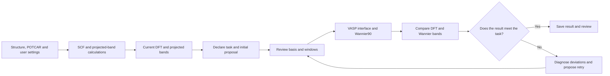
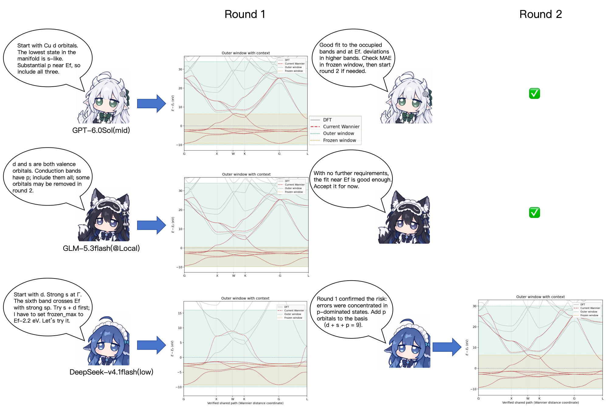

**[English](README.en.md) · [简体中文 →](README.md)**

# 🧭 WannierCompass


**Automate basis and window selection with AI to construct, check, and iteratively improve Wannier TB Hamiltonians.**


[Project overview](#project-overview) · [Quick start](docs/QUICKSTART.en.md) · [Cu example](#cu-example) · [Tests and cost](#test-results-and-cost-comparison) · [Documentation](#documentation) · [Roadmap](#roadmap) · [Usage advice](#known-issues-and-usage-recommendations)


<br clear="right" />

## Choose a workflow

| Version | Description | Get started |
|---|---|---|
| WannierCompass | Use MCP, a skill or the CLI to inspect projections, select a basis and windows, and construct and refine a Wannier Hamiltonian. | [Quick start](docs/QUICKSTART.en.md) |
| Small-model workflow | For locally deployed models (Qwen 3.5-122b @ 4x RTX 4090), with specialized roles, structured plans and handoffs. | [Quick start](extensions/small-model/QUICKSTART.en.md) |

<a id="latest-updates"></a>

**Latest updates**

<sub>2026-10-28 · v0.1.0 / small-model v0.2.0.dev11: add dedicated quick starts and an independent small-model workflow directory.<br>
2026-10-22 · v0.1.0: add batch-material tests, band-fit figures and cost comparisons.<br>
<a href="CHANGELOG.en.md">Full changelog →</a></sub>

## Project overview

**WannierCompass** is an AI scientific workflow tool for constructing Wannier tight-binding (TB) Hamiltonians from DFT calculations, currently supporting VASP → Wannier90. It provides an MCP server, skill and CLI to help different AI agents automatically select an orbital basis, disentanglement window and frozen window based on the research objective and current DFT projections, run calculations, and use DFT/Wannier band comparisons and orbital spreads to decide how to improve the TB Hamiltonian.

To favor symmetry retention and an interpretable orbital basis, the workflow strictly enforces **no maximal localization (`num_iter = 0`)**, constructing high-quality Wannier TB Hamiltonians through disentanglement only. Specific symmetry properties still require appropriate validation.

## Background

Constructing a useful Wannier TB Hamiltonian often involves repeated inspection of projected bands, orbital selection, window adjustment, band-fit review and spread analysis. Even for a fixed orbital basis, the disentanglement and frozen windows leave room for choices. The challenge is to translate the material's physics into a sensible construction strategy and next trial; experience from one material does not readily transfer to others with substantially different elemental compositions, space groups and band structures.

This project addresses a practical need in materials calculations. High-throughput studies of transport properties require Wannier TB Hamiltonians for large numbers of materials, while manually selecting orbitals, adjusting windows and checking band fits is time-consuming and difficult to scale. **WannierCompass organizes practical construction experience into callable tools and explicit decision workflows to support automated Wannier construction by AI agents with different capabilities, including locally deployed AI models. Researchers can also use the resulting initial Wannier TB Hamiltonians as a starting point and refine them for their specific scientific objectives.**

## What does it do?

| Stage | What the tools provide |
|---|---|
| Basic automated VASP workflow | With the calculation programs, licensed pseudopotential library and execution environment configured, the user can supply only POSCAR; an agent with file and command access prepares POTCAR and initial settings, runs SCF and projected-band calculations, checks outputs and generates Wannier inputs. Reliable production calculations should use a reviewed structure, POTCAR and calculation settings |
| Projection analysis | Organize orbital weights, band ranges and projection plots from the projected band path |
| Basis and window decisions | Automatically select the orbital basis, disentanglement window and frozen window from the research objective and projection analysis |
| Construct, check and improve the TB Hamiltonian | Run the VASP interface and Wannier90 disentanglement, then revise windows or the basis using band comparisons and orbital spreads; when DFT empty bands are insufficient, the agent can increase NBANDS and rerun the required non-self-consistent steps within the authorized compute scope before rebuilding and validating the TB Hamiltonian |

> ⚠️ **Choose appropriate VASP calculation settings.** Once VASP, Wannier90, a licensed pseudopotential library and the execution environment are configured, POSCAR can be the only material input supplied by the user, with the agent preparing the remaining files. Specify the functional, SOC, magnetism, dispersion treatment, cutoff, k-point sampling, empty-band budget and convergence criteria for the material and research objective when possible. With incomplete information, the agent can choose and record initial trial settings within the supported scope; those settings still require review and convergence checks. The built-in from-scratch generator currently supports static nonmagnetic PAW LDA/GGA, with optional SOC. Explicitly request HSE, meta-GGA, DFT+U, magnetism or settings such as `IVDW` when needed. An agent can help write these inputs, but the current built-in generator does not directly accept these settings (we strongly advise against running DFT calculations without understanding the material’s physical context and the calculation settings); separate integration and review are required. See [DFT preparation](wannier_mcp/workflow/docs/DFT-PREPARATION.md).

### One-line use

Ask the agent to download the toolkit from this repository and read the [Skill](SKILL.md). Once the calculation programs and input data are ready and computation is authorized, simply tell the agent:

> Use WannierCompass to construct a Wannier TB Hamiltonian for material XX.



<a id="cu-example"></a>

## 🐾 How does an AI construct Wannier TB Hamiltonians? A Cu example

The same Cu projected-band data can lead different agents to different first proposals. One may start with a broader basis; another may test a smaller orbital basis and add orbitals after inspecting missing or poorly fitted bands.

Face-centered cubic copper (fcc Cu), for which beginners can encounter fitting difficulties, illustrates how AI agents use WannierCompass. The tests used **GPT-6.0sol (mid) in Codex**, **GLM-5.3flash (locally deployed) in OpenCode**, and **DeepSeek-v4.1flash (low) in DeepSeek Harness**. The initial input supplied only the toolkit path, POSCAR, the required VASP calculation settings, and program and execution paths. No additional instructions specified the basis, windows or retry strategy; the task was simply:

> Complete the DFT calculations and construct the Wannier TB Hamiltonian for fcc Cu.

The figure illustrates how AI agents use WannierCompass to construct Wannier TB Hamiltonians: **inspect projections → choose a basis and windows → inspect the actual fit → retain the result or try a revision**.



*Check marks indicate that no further calculation round was performed. Users can request further adjustments based on the accuracy and fitting range they need.* [About the illustration](docs/CU-WORKFLOW-ILLUSTRATION.en.md)

## Test results and cost comparison

**New batch material tests:** WannierCompass reaches pass rates of 73% on a 100-material set including magnetic compounds and 79% on the literature SOC200 set. See [batch material tests and the literature comparison](docs/benchmarks/batch-material-tests.en.md) for results, construction attempts and per-material data.

For a batch of materials, the workflow first creates calculation directories. The agent completes DFT calculations using the material information and specified calculation settings. Once DFT calculations for the entire batch are complete, Wannier TB Hamiltonians are constructed and checked.

### Coverage of this test batch

| Unique materials | Periodic-group coverage | Space-group count | Crystal-system coverage |
|---|---|---|---|
| 35 | Main groups IA–VIIA and transition metals; 32 elements | 14 | Monoclinic, orthorhombic, tetragonal, trigonal, hexagonal and cubic; 6 systems |

See the [GPT band-fit PDF for all materials](benchmarks/gpt-band-fits.pdf). Each page identifies the material by name and preserves first attempts and retries.

### Selected fit results

The following six completed cases are shown:

| Material | Crystal system / space group | Basis / N_W | Total trials (including the first) | Actual DIS steps / converged | Target RMSE (meV) | Frozen RMSE (meV) |
|---|---|---|---|---|---|---|
| NbOI₂ | Monoclinic / P2 (3) | Nb:d, O:p, I:p / 56 | 1 | 48 / Yes | 1.396 | 0.655 |
| WS₂ (MX2_WS2) | Hexagonal / P-6m2 (187) | W:d, S:p / 22 | 2 | 60 / Yes | 21.100 | 19.466 |
| RhSi | Cubic / P2₁3 (198) | Rh:d, Si:s,p / 72 | 2 | 274 / Yes | 86.084 | 9.498 |
| BaFeAl | Hexagonal / P6/mmm (191) | Ba:d, Fe:d, Al:s,p / 102 | 2 | 602 / Yes | 535.868 | 6.109 |
| SbP | Orthorhombic / Pmn2₁ (31) | Sb:p, P:p / 24 | 2 | 111 / Yes | 179.117 | 8.453 |
| Bi₂Se₂O₂ | Tetragonal / P4/nmm (129) | Bi:p, Se:p, O:p / 36 | 1 | 22 / Yes | 7.418 | 3.732 |

**GPT · band fits across the DIS windows**


**See the [high-resolution PDF](docs/assets/gpt-selected-six-dis.pdf) for the frozen-window ranges.**

### Batch running costs

Summarize the complete run over the same batch of materials, documenting the material count, calculation scope and usage sources in the detailed records.

| AI model and settings | Total tokens (M, input / output) | Cache hit rate | MAE passes within at most 3 trials | Total cost / average cost per material |
|---|---|---|---|---|
| GPT* | 743.895 / 4.066 | 97.33% | 33/35 | ≈¥13.45 / ≈¥0.38 |
| GLM (locally deployed) | 220.2 / 0.88 | 97.3% | 32/35 | ≈¥52.79 / ≈¥1.51 |
| DeepSeek | 711.1 / 5.8 | 97.6% | 33/35** | ¥12.91 / ≈¥0.37 |

Cache hit rate is the fraction of total input tokens served from cache. GLM cost is estimated at reference API rates.

\* **GPT cost is roughly allocated from subscription-quota usage, assuming about 4% of a weekly allowance.** Token counts and cache hit rate are estimates from the related conversations; GPT autonomously launches subagents to assist with evaluation and batch calculations, and the figures include related troubleshooting and review. For some cases that did not pass, GPT paused and summarized the results while awaiting further user instructions; subsequent attempts following that interaction are excluded from this test.

\*\* DeepSeek uses a lower frozen-window upper bound for the conduction bands.

### Workflow ablation: cost comparison

Current frontier AI models can still construct good TB Hamiltonians without this workflow by consulting documentation online or making multiple attempts. Using Cu as the example, each paired test keeps its own setup consistent between the with-workflow and without-workflow conditions; online documentation access is unrestricted without the workflow. This is a simple comparative test for analyzing costs and tool performance. Given the time required, a large-scale comparison across multiple materials has not yet been conducted.

| <sub>AI</sub> | <sub>Workflow</sub> | <sub>Trials</sub> | <sub>Tokens (M)<br>in / out</sub> | <sub>Cache hit<br>(%)</sub> | <sub>DIS steps</sub> | <sub>Frozen MAE<br>(meV)</sub> | <sub>API cost<br>(RMB)</sub> | <sub>Notes</sub> |
|---|---|---|---|---|---|---|---|---|
| <sub>GPT</sub> | <sub>Yes</sub> | <sub>Total: 1<br>spd×1</sub> | <sub>15.254<br>0.064</sub> | <sub>97.48</sub> | <sub>194</sub> | <sub>11.40</sub> | <sub>≈19.47</sub> |  |
| <sub>GPT</sub> | <sub>No</sub> | <sub>Total: 3<br>spd×3</sub> | <sub>18.027<br>0.118</sub> | <sub>97.61</sub> | <sub>243</sub> | <sub>10.70</sub> | <sub>≈25.57</sub> | <sub>Online: official VASP/Wannier90 docs</sub> |
| <sub>GLM (local)</sub> | <sub>Yes</sub> | <sub>Total: 1<br>spd×1</sub> | <sub>17.677<br>0.034</sub> | <sub>98.40</sub> | <sub>177</sub> | <sub>7.3</sub> | <sub>≈3.90–4.03</sub> |  |
| <sub>GLM (local)</sub> | <sub>No</sub> | <sub>Total: 3<br>sd×3</sub> | <sub>17.050<br>0.030</sub> | <sub>98.83</sub> | <sub>525</sub> | <sub>49.4</sub> | <sub>≈3.70–4.04</sub> | <sub>Failed: 5,000 localization steps,<br>s-orbital spread: 25 Ų<br>(AI judged it passed and stopped)</sub> |
| <sub>DeepSeek</sub> | <sub>Yes</sub> | <sub>Total: 2<br>sd×1 + spd×1</sub> | <sub>38.541<br>0.175</sub> | <sub>99.50</sub> | <sub>147</sub> | <sub>17.6</sub> | <sub>1.66</sub> |  |
| <sub>DeepSeek</sub> | <sub>No</sub> | <sub>Total: 8<br>sd×2 + spd×6</sub> | <sub>32.360<br>0.536</sub> | <sub>97.13</sub> | <sub>1,016</sub> | <sub>28.39</sub> | <sub>3.70</sub> |  |

Maybe Cu is the “pelican riding a bicycle” test of materials calculations? 👀

<sub><strong>Test setup:</strong> Conversations about scientific choices start with fresh context. General-purpose skills in Codex and OpenCode provide operational knowledge, including server operation, troubleshooting and DFT script locations. DeepSeek Harness uses <strong>dsh-mnemon</strong> to manage memory, with the aim of avoiding carryover of prior Wannier-specific experience. These tests use the WannierCompass toolkit published in this repository (see each batch record for the exact version), without a user-maintained experience library or additional Wannier prompts derived from prior experience.</sub>

## Documentation

English skills and operational documents are canonical. Chinese reading translations live in a separate directory; the default project homepage has bilingual introduction/background paragraphs and Chinese main content.

| Topic | Reference |
|---|---|
| Full-band TB Hamiltonian, windows and good-result features | [Construction overview](wannier_mcp/workflow/docs/CONSTRUCTION-OVERVIEW.md) |
| First-trial decisions | [First-trial card](wannier_mcp/workflow/docs/FIRST-TRIAL-CARD.md) |
| What to change after a poor fit | [Window retries](wannier_mcp/workflow/docs/WINDOW-RETRIES.md) |
| Inputs, outputs and calls | [Interfaces](wannier_mcp/workflow/docs/INTERFACES.md) |
| Commands and runtime entry points | [Runtime](wannier_mcp/workflow/docs/RUNTIME.md) |
| Plots and result review | [Plotting](wannier_mcp/workflow/docs/PLOTTING.md) |
| User experience library (not included in this release) | [User experience library](wannier_mcp/workflow/docs/USER-EXPERIENCE-LIBRARY.md) |

[Chinese reference documents](wannier_mcp/workflow/docs/zh-CN/README.md)

## Current scope

- Material calculations have been tested with **VASP 6** and **Wannier90 3.1**.
- The parser supports complete resolved `s/p/d` and `s/p/d/f` charge projections. Wannier construction for f-electron materials still lacks broad testing.
- Initial evidence comes from the projected band path; the actual Wannier mesh is checked after interface generation. An extra DOS mesh is not a prerequisite.
- `dis_num_iter` is separate from `num_iter` and capped at 10,000. The default is `num_iter = 0`. Requested outputs include `hr/rmn/tb` and bands.
- Completion, disentanglement convergence, band fit and physical/symmetry acceptance are checked separately.
- An overall band-fit deviation below **20 meV** within the frozen window is a provisional main reference for assessment. Tell the agent to adjust the error metric and criterion for your task, or specify only a maximum trial count without a fixed error threshold.

For an installation or plotting smoke test, generate disposable invented data outside the repository:

```bash
python examples/make_synthetic_case.py --out-dir /tmp/wannier-synthetic-case
```

This fixture checks technical behavior rather than material-fitting quality.

## Roadmap

- Broader independent material tests and comparisons between AI models, with clearer case demonstrations.
- Better multi-trial diagnosis and fewer ineffective retries or unnecessary agent outputs.
- Optional experience retrieval, evaluated separately from retrieval-free construction.
- Few-band TB Hamiltonians, symmetry constraints and the corresponding physical validation workflows.

See the [roadmap](ROADMAP.md). This is an evolving research project; feedback is welcome, including ideas that make scientific tools clearer, more useful and more enjoyable to use.

## Known issues and usage recommendations

### 1. Specify the fitting objective and priority energy range

A simple request such as “Construct the Wannier TB Hamiltonian for material XX” is usually enough to start automated construction. However, in tests without an explicit fitting objective, GPT, GLM and DeepSeek showed somewhat different preferences for bases and windows. The appropriate choice depends on the research objective; frozen-window size or its fit error alone does not determine which TB Hamiltonian better serves the task.

In practice, telling the agent which research question matters helps it adjust its assessment criteria. For example, a CDW question focused on the Fermi surface, or an ARPES comparison focused on occupied valence states, can prioritize the corresponding near-Fermi or valence range. Optical responses, such as bulk photovoltaic effects associated with visible light, also call for attention to a broader valence/conduction range. A user might request accurate fitting within `E_F ± 3 eV`. Choose the actual range for the transitions and frequencies being studied; `±3 eV` is an example task specification, and no universal fixed window is required.

In current tests without an explicit conduction-protection request, DeepSeek v4.1 Flash tended to favor primarily valence-protecting frozen windows for some large-gap insulators, whereas agents such as GLM tended to protect broader portions of both valence and conduction. To request more conduction protection, add:

> I need a good conduction-band fit. Freeze as much of the target conduction manifold as the orbital evidence and state-by-state checks allow, and validate the fit in that range.

### 2. DeepSeek reasoning effort for batch calculations (important)

In the project's current batch tests, DeepSeek sometimes lost focus, repeated its reasoning or made inconsistent decisions after handling roughly 10–20 or more materials in one long conversation. We recommend setting **DeepSeek reasoning effort to Low**; in existing tests, Low has been sufficient to carry out construction tasks with the workflow.

For the tested DeepSeek v4.1 Flash, High/Max settings can lead to excessively long reasoning, increasing token usage and waiting time and potentially affecting later decisions. Unless context compression tools or prompts tailored to long batches are in place, high reasoning effort is therefore not recommended for batch calculations. This issue has not been observed in the project's existing GLM and GPT tests. These recommendations reflect current tests and may change with the AI version, execution framework and context management.

### 3. This release is not yet optimized for specialized few-band construction

Depending on the research objective, an agent can be asked to try a smaller orbital basis and reduce `num_wann`, adjust the frozen protection ranges in the valence and conduction bands accordingly, then check the target-range fit and orbital spreads. However, constructing a specific few-band TB Hamiltonian depends strongly on the research objective and researcher experience, and results vary by material. This release does not yet provide a decision workflow optimized for such tasks.

More specialized construction may involve maximal localization or projections at sites not occupied by atoms, for example when constructing few-band TB Hamiltonians for obstructed atomic insulators. These extensions require separate integration and review. **This release still requires `num_iter = 0`, but users can remove this restriction by explicitly modifying the relevant workflow policies and validation checks.** Future work will develop clearer guidance on few-band selection, projection sites and the corresponding acceptance criteria.

### 4. Build and reuse your own material experience over time

For long-term use, gradually organize experience from completed calculations: record the material structure, orbital basis, disentanglement and frozen windows, actual band fits, and the reasons for adjustments. When processing related structures or substitutions by elements in the same chemical group, an agent can use validated results from similar materials to choose a better initial basis and windows. This reduces repeated analysis and ineffective trials, saving tokens and computation. References can also be organized by the correspondence between Wyckoff positions and atomic orbitals to support reuse across related structures.

For example, some Ba- and Sr-containing systems in our calculations required the nominally unoccupied `Ba:d` or `Sr:d` orbitals in the target TB Hamiltonian, together with a disentanglement window extending sufficiently high into the unoccupied bands to provide adequate states for DIS. Without relevant experience, agents such as GPT may eventually find a suitable setup but first run an inadequate trial, then add the d orbitals and progressively increase `dis_win_max` over subsequent trials. Records from similar materials can help identify these needs earlier and suggest a more suitable starting setup.

### 5. Limitations of the construction method

Orbital and window optimization remain limited by the available projector basis; in some systems, adding hydrogenic projectors may be necessary to obtain a high-quality Wannier model. See the results and discussion in [our batch material tests and literature comparison](docs/benchmarks/batch-material-tests.en.md#discussion-and-implications).

## Contact

[chenhao_liang2000@163.com](mailto:chenhao_liang2000@163.com) · [chenhao_liang@iphy.ac.cn](mailto:chenhao_liang@iphy.ac.cn)
