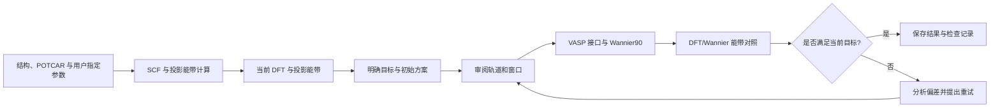
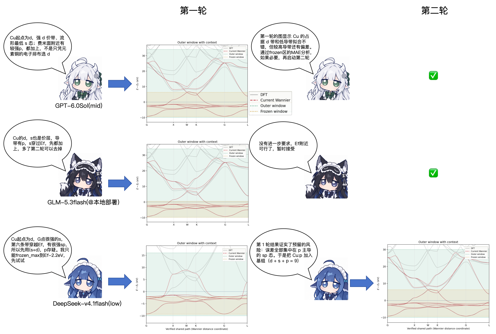
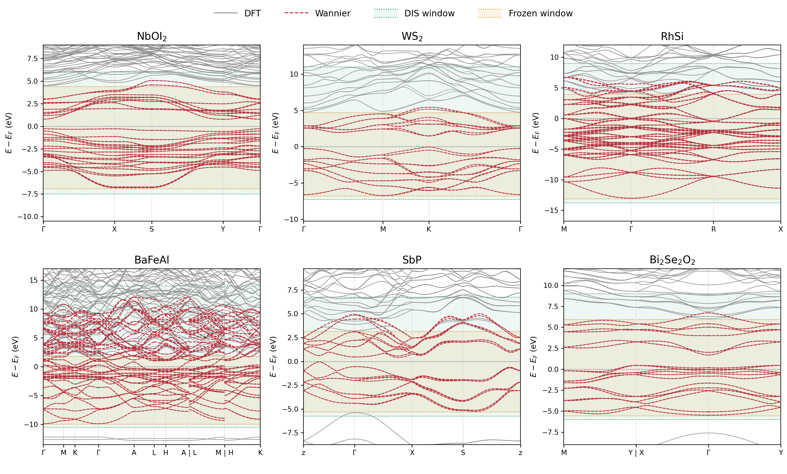

**[简体中文](README.md) · [English →](README.en.md)**


# 🧭 WannierCompass


**让 AI 全自动选取基组、判断窗口，构造、检查并逐步改进 Wannier TB 哈密顿量。**
*Automate basis and window selection with AI to construct, check, and iteratively improve Wannier TB Hamiltonians.*

[极简使用](#极简使用) · [Cu 示例](#cu-example) · [快速开始](#快速开始) · [测试与成本](#测试效果与成本对比) · [文档导航](#文档导航) · [后续计划](#后续计划) · [使用建议](#已知问题与使用建议)


<br clear="right" />

## 简介 · Introduction

**WannierCompass** 是面向 DFT → Wannier 构造的 AI 科学工作流工具（当前支持 VASP → Wannier90），用于构造 Wannier 紧束缚（TB）哈密顿量。它提供 MCP 服务、Skill 和命令行入口，帮助不同 AI 根据研究目标和当前 DFT 投影信息，自动选择构造 Wannier TB 哈密顿量所需的轨道基组、解纠缠窗口与 frozen 窗口，执行计算，并结合 DFT/Wannier 能带对照、轨道展宽（spread）等信息判断下一步如何改进。

**WannierCompass** is an AI scientific workflow tool for constructing Wannier tight-binding (TB) Hamiltonians from DFT calculations, currently supporting VASP → Wannier90. It provides an MCP server, skill and CLI to help different AI agents automatically select an orbital basis, disentanglement window and frozen window based on the research objective and current DFT projections, run calculations, and use DFT/Wannier band comparisons and orbital spreads to decide how to improve the TB Hamiltonian.

为尽可能保持对称性和轨道基组的可解释性，工具严格要求**不进行最局域化（`num_iter = 0`）**，在仅解纠缠的基础上构造高质量 Wannier TB 哈密顿量。具体对称性是否满足，仍需通过相应检查确认。

To favor symmetry retention and an interpretable orbital basis, the workflow strictly enforces **no maximal localization (`num_iter = 0`)**, constructing high-quality Wannier TB Hamiltonians through disentanglement only. Specific symmetry properties still require appropriate validation.

## 背景 · Background

做 Wannier 往往需要反复看投影能带、选轨道、调窗口，再从拟合图和轨道展宽中找问题。对于给定的轨道基组，解纠缠窗口和 frozen 窗口仍具有一定选择自由度。难点在于把材料的物理特点转化为合理的构造方案与下一次尝试；某一材料的经验，很难直接迁移到元素组成、空间群和能带结构截然不同的其他材料上。

Constructing a useful Wannier TB Hamiltonian often involves repeated inspection of projected bands, orbital selection, window adjustment, band-fit review and spread analysis. Even for a fixed orbital basis, the disentanglement and frozen windows leave room for choices. The challenge is to translate the material's physics into a sensible construction strategy and next trial; experience from one material does not readily transfer to others with substantially different elemental compositions, space groups and band structures.

本项目源于实际材料计算中的需求。高通量研究材料输运性质，需要大规模构造 Wannier TB 哈密顿量，而人工逐一选择轨道、调整窗口和检查拟合结果，往往耗时且难以规模化。**WannierCompass 将 Wannier 构造经验整理为可调用的工具和明确的判断流程，支持不同能力的 AI，包括本地部署的 AI 模型，进行自动化 Wannier 构造。研究者也可以将其生成的初步 TB 哈密顿量作为后续计算的起点，并根据具体研究目标进一步调整。**

This project addresses a practical need in materials calculations. High-throughput studies of transport properties require Wannier TB Hamiltonians for large numbers of materials, while manually selecting orbitals, adjusting windows and checking band fits is time-consuming and difficult to scale. **WannierCompass organizes practical construction experience into callable tools and explicit decision workflows to support automated Wannier construction by AI agents with different capabilities, including locally deployed AI models. Researchers can also use the resulting initial Wannier TB Hamiltonians as a starting point and refine them for their specific scientific objectives.**

**The following sections are in Chinese. [Read the English version →](README.en.md)**

## 它能做什么？

| 环节 | 工具提供什么 |
|---|---|
| 基础自动 VASP 工作流 | 在计算程序、许可赝势库和执行环境已配置时，用户可仅提供 POSCAR，由具备文件与命令操作能力的 Agent 补齐 POTCAR 和起始参数，准备并运行 SCF 与投影能带计算，检查输出并生成后续 Wannier 素材；可靠的生产计算应使用经过确认的结构、POTCAR 和计算参数 |
| 投影分析 | 从投影能带路径整理轨道权重、能带范围和投影图 |
| 基组／窗口决策 | 根据研究目标与投影分析，全自动选取轨道基组、解纠缠窗口和 frozen 窗口 |
| 构造、检查与改进 TB 哈密顿量 | 运行 VASP 接口与 Wannier90 解纠缠，根据能带对照和轨道 spread 调整窗口或基组；DFT 空带不足时，由 Agent 在获授权的计算范围内增加 NBANDS、补算所需非自洽步骤，再构造并验证 TB 哈密顿量 |

> ⚠️ **请合理设置 VASP 的计算参数。** 已配置 VASP、Wannier90、许可赝势库等必要路径及执行环境后，POSCAR 可以作为用户提供的唯一材料输入，由 Agent 准备其余文件。建议根据材料和研究目的，向 Agent 明确泛函、SOC、磁性、色散修正、截断能、k 点采样、空带数量及收敛要求。信息不足时，Agent 可以在工具支持的范围内选择并记录一组起始参数用于试算，但仍需复核与收敛性检查。当前内置从零生成通路支持静态非磁 PAW LDA/GGA，可选是否开启 SOC。HSE、meta-GGA、DFT+U、磁性和 `IVDW` 等需求应明确提出；Agent 可以协助编写这些输入，但当前内置生成器尚不直接接受这些设置（强烈不建议在不了解材料物理背景和计算设置的情况下开展 DFT 计算），需要单独适配和复核。详见 [DFT 准备说明](wannier_mcp/workflow/docs/DFT-PREPARATION.md)。

### 极简使用

告诉 Agent 从本仓库下载工具包并阅读 [Skill](SKILL.md)。当计算程序与输入数据就绪，并已授权计算后，可以直接告诉 Agent：

> 使用 WannierCompass，帮我做 XX 材料的 Wannier TB 哈密顿量。



<a id="cu-example"></a>

## 🐾 AI 如何做 Wannier？——以 Cu 为例

同一份 Cu 投影能带，不同 AI 可以提出不同的首次方案。有的从较完整的基组开始，有的先尝试较小的轨道基组，再根据拟合中缺失或偏差较大的能带补充轨道。

以新手容易遇到拟合困难的面心立方铜（fcc Cu）为例，展示 AI Agent 如何使用 WannierCompass。测试分别使用 **GPT-6.0sol（mid）@Codex**、**GLM-5.3flash（本地部署）@OpenCode** 和 **DeepSeek-v4.1flash（low）@DeepSeek Harness**。首次输入只提供工具包路径、POSCAR、VASP 计算所需参数与相关程序及执行路径，未额外指定基组、窗口或重试策略，仅要求：

> 完成 DFT 计算，并做好 fcc-Cu 的 Wannier。

下图直观展示 AI Agent 使用 WannierCompass 构造 Wannier TB 哈密顿量的过程：**观察投影 → 选择轨道和窗口 → 看实际拟合 → 决定保持结果还是继续尝试。**



*图中勾号表示不再进行下一轮计算；用户也可以根据所需精度和拟合范围，要求 AI 进一步调整。* [图示说明](docs/CU-WORKFLOW-ILLUSTRATION.md)

## 快速开始

### 1. 安装

文件分析和绘图需要 Python 3.10+。实际计算还需要用户自行提供 VASP、Wannier90、合适的输入数据和执行环境。仓库不分发这些程序、POTCAR 或波函数文件。

```bash
git clone https://github.com/isinglch/wannier-compass.git
cd wannier-compass
python -m venv .venv
source .venv/bin/activate
pip install -e .
```

### 2. 选择入口

**a. 以 Skill 和 tools 方式直接阅读和调用工具包。**

完成上面的下载和安装后，让具备文件与命令操作能力的 Agent 阅读 [SKILL.md](SKILL.md) 和[全带 Wannier 概览](wannier_mcp/workflow/docs/CONSTRUCTION-OVERVIEW.md)，再按[首次尝试卡](wannier_mcp/workflow/docs/FIRST-TRIAL-CARD.md)选择基组与窗口、调用工具并检查结果。这是目前真实材料测试主要采用的方式，无需先配置 MCP。

例如，可以这样明确要求启动计算和后续重试：

> 请使用指定路径下的 WannierCompass 工具包，为这个材料构造 Wannier TB 哈密顿量。先阅读 Skill 和 construction overview，再按首次尝试卡使用当前输入。复用已有 DFT 数据；需要补充计算时，使用我提供的 VASP 参数与程序路径。我授权你在指定工作区和资源范围内实际启动计算。每轮保存选择图，检查 DFT/Wannier 能带对照、收敛与轨道 spread；满足研究目标时停止，不满足时按重试指导继续，最多进行三轮尝试（含首次）。

请向 Agent 提供材料输入、拟合目的、执行环境和资源限制，并明确是否授权计算及最多尝试多少轮。文件／CLI 方式的执行命令见[运行卡](wannier_mcp/workflow/docs/RUNTIME.md)。

**b. MCP（可选）：连接支持 MCP 的 AI Agent。**

MCP 已有接口与运行测试，完全独立客户端中的广泛计算测试仍待完善。配置服务后，先调用 `workflow_guide`，按返回路径读取 Skill、construction overview 和执行说明。

```json
{
  "mcpServers": {
    "wannier-compass": {
      "command": "/absolute/path/to/.venv/bin/wannier-compass",
      "env": {
        "WAN_WORKSPACE_ROOT": "/absolute/path/to/authorized-workspace"
      }
    }
  }
}
```

MCP 提交入口默认只预览。授权实际计算后，还需在 MCP 服务环境中设置 `WAN_ALLOW_SUBMIT=1`，并在提交调用中显式指定 `execute=true`。

**c. 直接调用 CLI 使用。**

阅读[运行卡](wannier_mcp/workflow/docs/RUNTIME.md)与[输入输出接口](wannier_mcp/workflow/docs/INTERFACES.md)，按文件接口准备输入并调用命令。

### 3. 从已有 DFT 计算开始

已有匹配的 SCF、投影能带和波函数时，可以复用这些素材，或补全缺少的计算；新基组仍需运行 VASP–Wannier90 非自洽（NSCF）接口步骤，生成对应的投影矩阵等文件。相关输入要求见 [DFT 准备说明](wannier_mcp/workflow/docs/DFT-PREPARATION.md)；工具入口见[参考工具](wannier_mcp/workflow/docs/REFERENCE-TOOLS.md)。

证据分析与科学输入输出接口不要求 SSH 或 Slurm。目前随包提供的全流程执行集成是可选的 [Slurm 参考适配器](wannier_mcp/workflow/docs/SLURM-EXAMPLE.md)；其他执行环境（如 PBS）需要相应的简单适配。

## 测试效果与成本对比

以一组材料计算为例：工作流先根据材料生成计算文件夹，Agent 根据材料信息和指定的计算参数完成 DFT 计算。待整批材料的 DFT 计算完成后，再统一进行 Wannier TB 哈密顿量构造与检查。

### 本案例测试覆盖

| 独立材料数 | 元素族覆盖 | 空间群数 | 晶系覆盖 |
|---|---|---|---|
| 35 | IA–VIIA 主族及过渡金属，共 32 种元素 | 14 | 单斜、正交、四方、三方、六方、立方，共 6 类 |

完整能带对照见 [GPT 全材料拟合图 PDF](benchmarks/gpt-band-fits.pdf)，各页直接标注材料名称，并保留首次与重试结果。

### 摘选案例的拟合结果

以下展示已完成的六个案例：

| 材料 | 晶系 / 空间群 | 基组 / N_W | 总尝试轮数（含首次） | 实际 DIS 步数 / 收敛 | 目标 RMSE（meV） | frozen RMSE（meV） |
|---|---|---|---|---|---|---|
| NbOI₂ | 单斜 / P2（3） | Nb:d, O:p, I:p / 56 | 1 | 48 / 是 | 1.396 | 0.655 |
| WS₂（MX2_WS2） | 六方 / P-6m2（187） | W:d, S:p / 22 | 2 | 60 / 是 | 21.100 | 19.466 |
| RhSi | 立方 / P2₁3（198） | Rh:d, Si:s,p / 72 | 2 | 274 / 是 | 86.084 | 9.498 |
| BaFeAl | 六方 / P6/mmm（191） | Ba:d, Fe:d, Al:s,p / 102 | 2 | 602 / 是 | 535.868 | 6.109 |
| SbP | 正交 / Pmn2₁（31） | Sb:p, P:p / 24 | 2 | 111 / 是 | 179.117 | 8.453 |
| Bi₂Se₂O₂ | 四方 / P4/nmm（129） | Bi:p, Se:p, O:p / 36 | 1 | 22 / 是 | 7.418 | 3.732 |

**GPT · DIS 窗口能带对照**



**frozen 范围详见[高清 PDF](docs/assets/gpt-selected-six-dis.pdf)。**

### 整批材料的运行成本

按同一批材料的完整运行统计，并在详细记录中注明材料数、计算范围和用量来源。

| AI 模型与配置 | 总 token（M，输入 / 输出） | 缓存命中率 | 至多3轮内的 MAE 判定通过数 | 总成本 / 单材料平均成本 |
|---|---|---|---|---|
| GPT* | 743.895 / 4.066 | 97.33% | 33/35 | ≈¥13.45 / ≈¥0.38 |
| GLM（本地部署） | 220.2 / 0.88 | 97.3% | 32/35 | ≈¥52.79 / ≈¥1.51 |
| DeepSeek | 711.1 / 5.8 | 97.6% | 33/35** | ¥12.91 / ≈¥0.37 |

缓存命中率按缓存命中的输入 token 占总输入 token 的比例统计。GLM 费用按参考 API 单价估算。

\* **GPT 费用按订阅额度消耗粗估（按消耗周额度～4%计）**。token、缓存命中率等为相关会话的估算；GPT 会自主启动自代理协助评估和分批计算，统计包含相关排错与复核消耗。 部分未通过的体系中，GPT 会先停止计算并整理结果，等待进一步交互指示后再运行；本次测试不计入后续交互产生的尝试。

\*\* DeepSeek 的导带 frozen 较低。

### 工作流消融实验：成本对照

对于当前前沿大模型，即使不使用本工作流，通过联网查阅文档或多轮尝试，仍可以构造较好的 TB 哈密顿量。以 Cu 为例，每组有／无工作流的对照内部保持一致，分别记录两种条件下的结果（不使用工作流时不限制联网查阅）。这是用于分析成本消耗与工具性能的简易对照测试；考虑到时间成本，尚未开展大规模、多材料的对比测试。

| <sub>AI</sub> | <sub>工作流</sub> | <sub>尝试轮次</sub> | <sub>token（M）<br>输入 / 输出</sub> | <sub>缓存命中<br>（%）</sub> | <sub>DIS 步数</sub> | <sub>frozen MAE<br>（meV）</sub> | <sub>API 费用<br>（RMB）</sub> | <sub>备注</sub> |
|---|---|---|---|---|---|---|---|---|
| <sub>GPT</sub> | <sub>是</sub> | <sub>共1轮<br>spd×1</sub> | <sub>15.254<br>0.064</sub> | <sub>97.48</sub> | <sub>194</sub> | <sub>11.40</sub> | <sub>≈19.47</sub> |  |
| <sub>GPT</sub> | <sub>否</sub> | <sub>共3轮<br>spd×3</sub> | <sub>18.027<br>0.118</sub> | <sub>97.61</sub> | <sub>243</sub> | <sub>10.70</sub> | <sub>≈25.57</sub> | <sub>联网查阅 VASP/Wannier90 官方文档</sub> |
| <sub>GLM（本地）</sub> | <sub>是</sub> | <sub>共1轮<br>spd×1</sub> | <sub>17.677<br>0.034</sub> | <sub>98.40</sub> | <sub>177</sub> | <sub>7.3</sub> | <sub>≈3.90–4.03</sub> |  |
| <sub>GLM（本地）</sub> | <sub>否</sub> | <sub>共3轮<br>sd×3</sub> | <sub>17.050<br>0.030</sub> | <sub>98.83</sub> | <sub>525</sub> | <sub>49.4</sub> | <sub>≈3.70–4.04</sub> | <sub>失败：最局域化5,000步，<br>s轨道 spread：25 Ų<br>（AI判断通过而停止）</sub> |
| <sub>DeepSeek</sub> | <sub>是</sub> | <sub>共2轮<br>sd×1 + spd×1</sub> | <sub>38.541<br>0.175</sub> | <sub>99.50</sub> | <sub>147</sub> | <sub>17.6</sub> | <sub>1.66</sub> |  |
| <sub>DeepSeek</sub> | <sub>否</sub> | <sub>共8轮<br>sd×2 + spd×6</sub> | <sub>32.360<br>0.536</sub> | <sub>97.13</sub> | <sub>1,016</sub> | <sub>28.39</sub> | <sub>3.70</sub> |  |

也许Cu是材料计算的鹈鹕骑单车测试？👀

<sub><strong>测试设置：</strong>各 AI 的科学选择在全新上下文的对话窗口中进行。Codex、OpenCode 的通用 Skill 提供服务器使用、自主排错和 DFT 计算脚本路径等环境知识；DeepSeek Harness 通过 <strong>dsh-mnemon</strong> 管理记忆，以避免引入历史 Wannier 经验。以下测试使用本仓库发布的 WannierCompass 工具包（具体版本见各批次记录），不使用基于用户的经验库，也不额外提供与 Wannier 相关的经验性 prompt。</sub>

## 文档导航

英文 Skill 与执行文档是规范主版本；本主页面向中文阅读，详细中文译本放在独立目录。

| 想了解什么 | English | 中文 |
|---|---|---|
| 全带 Wannier 的目标、窗口和结果特征 | [Construction overview](wannier_mcp/workflow/docs/CONSTRUCTION-OVERVIEW.md) | [概览](wannier_mcp/workflow/docs/zh-CN/CONSTRUCTION-OVERVIEW.md) |
| 首次怎么判断 | [First-trial card](wannier_mcp/workflow/docs/FIRST-TRIAL-CARD.md) | [首次尝试卡](wannier_mcp/workflow/docs/zh-CN/FIRST-TRIAL-CARD.md) |
| 做不好后怎么改 | [Window retries](wannier_mcp/workflow/docs/WINDOW-RETRIES.md) | [窗口重试](wannier_mcp/workflow/docs/zh-CN/WINDOW-RETRIES.md) |
| 输入、输出与调用接口 | [Interfaces](wannier_mcp/workflow/docs/INTERFACES.md) | [接口说明](wannier_mcp/workflow/docs/zh-CN/INTERFACES.md) |
| 命令与运行入口 | [Runtime](wannier_mcp/workflow/docs/RUNTIME.md) | [运行卡](wannier_mcp/workflow/docs/zh-CN/RUNTIME.md) |
| 绘图与结果检查 | [Plotting](wannier_mcp/workflow/docs/PLOTTING.md) | [绘图](wannier_mcp/workflow/docs/zh-CN/PLOTTING.md) |
| 基于用户的经验库（本版本未上传） | [User experience library](wannier_mcp/workflow/docs/USER-EXPERIENCE-LIBRARY.md) | [经验库说明](wannier_mcp/workflow/docs/zh-CN/USER-EXPERIENCE-LIBRARY.md) |

[全部中文参考文档](wannier_mcp/workflow/docs/zh-CN/README.md)

## 当前能力与使用边界

- 当前材料计算测试基于 **VASP 6** 与 **Wannier90 3.1**。
- 解析器支持完整 resolved `s/p/d` 和 `s/p/d/f` charge 投影格式。含 f 电子的 Wannier 构造仍然缺乏广泛测试。
- 初始判断来自投影能带路径；接口生成后再检查实际 Wannier 网格，不要求先加做 DOS 网格。
- `dis_num_iter` 独立于 `num_iter`，上限为 10,000。默认 `num_iter = 0`。输出包含 `hr/rmn/tb` 和能带。
- 计算完成、解纠缠收敛、能带拟合与物理/对称性验收分别检查。
- 暂以 frozen 窗口内的总体拟合偏差小于 **20 meV** 作为主要判断参考；具体误差指标与标准可以直接告知 Agent 调整，也可以只限定最大尝试轮数，不指定误差标准。

仅想检查安装与绘图入口，可以在仓库外生成虚构数据：

```bash
python examples/make_synthetic_case.py --out-dir /tmp/wannier-synthetic-case
```

这些虚构数据用于技术检查，不能证明材料拟合能力。

## 后续计划

- 持续扩大材料与不同 AI 的独立测试，整理更清楚的案例展示。
- 完善多轮诊断，减少无效重试和不必要的 Agent 输出。
- 探索可关闭的经验检索，并与无经验检索的测试分开评价。
- 发展少带 TB 哈密顿量、对称性约束与相应的物理验收流程。

详见 [Roadmap](ROADMAP.md)。这是持续开发的研究项目，欢迎使用反馈，也欢迎一起把科学工具做得清楚、好用、好看。

## 已知问题与使用建议

### 1. 明确拟合目的与重点能量范围

通常只需告诉 Agent“请构造 XX 材料的 Wannier”，即可启动 Wannier TB 哈密顿量的自动构造。但在未明确拟合目标的测试中，GPT、GLM、DeepSeek 等对基组和窗口的选择偏好略有不同。实际哪种选取更合适，取决于研究目的，不能只比较 frozen 的大小或其中的拟合误差。

实际使用中，告诉 Agent 关心的研究问题，就能帮助它调整判断标准。例如，如果是费米面附近的 CDW 问题，或占据价带的 ARPES 对照，可以优先保证相关费米面或价带范围的拟合。对于光学响应，如与可见光相关的体光伏效应，往往还需关注较宽的价带与导带范围；用户可以提出“重点保证 `E_F ± 3 eV` 内的拟合”等具体要求。实际范围应根据研究中的跃迁与频率确定，`±3 eV` 是任务示例，无需采用通用固定窗口。

在目前的测试中，未明确要求导带保护时，DeepSeek v4.1 Flash 在部分大带隙绝缘体上倾向于采用主要保护价带的 frozen 窗口，而 GLM 等更倾向于同时扩大价带与导带的保护范围。如果希望 DeepSeek 多保护一些导带，可以直接补充：

> 我需要较好的导带拟合。请在目标轨道证据和逐态检查允许的范围内，尽可能多地冻结目标导带，并验证这部分的拟合。

### 2. 批量计算中 DeepSeek 的思考强度设置（重要）

在本项目目前的批量测试中，DeepSeek 在同一长对话中连续处理约 10–20 个以上材料时，有时会出现注意力分散、反复思考或判断不一致。建议将 **DeepSeek 的思考强度设为 Low**；现有测试中，Low 已能借助工作流完成构造任务。

对于当前测试的 DeepSeek v4.1 Flash，High/Max 设置可能使它陷入超长思考，增加 token 消耗和等待时间，还可能影响后续判断。因此，如果没有针对长批次准备上下文压缩工具或专门的提示词设计，不建议在批量计算中开启高强度思考。本项目现有的 GLM 和 GPT 测试中，未观察到这一问题；这些建议基于当前测试，会随 AI 版本、执行框架和上下文管理方式变化。

### 3. 当前版本尚未针对特定少带构造优化

可以根据研究目标，要求 Agent 尝试缩小轨道基组、减少 `num_wann`，并相应调整价带和导带的 frozen 保护范围，再检查目标范围内的拟合与轨道 spread。但特定少带 TB 哈密顿量的构造强烈依赖研究目的和研究者经验，效果因材料而异，当前发布版尚未提供专门优化的判断流程。

更专门的构造还可能涉及开启最局域化，或在没有原子占据的位置设置投影，例如为阻塞原子绝缘体构造少带 TB 哈密顿量。这些扩展需要另行适配和复核；**当前发布版仍要求 `num_iter = 0`，但用户可以明确修改相关工作流策略与校验，去除这一限制。** 后续将进一步完善少带选取、投影位置和相应的验收标准，以更明确的方式指导 Agent 处理这些问题。

## 联系我

[chenhao_liang2000@163.com](mailto:chenhao_liang2000@163.com) · [chenhao_liang@iphy.ac.cn](mailto:chenhao_liang@iphy.ac.cn)
