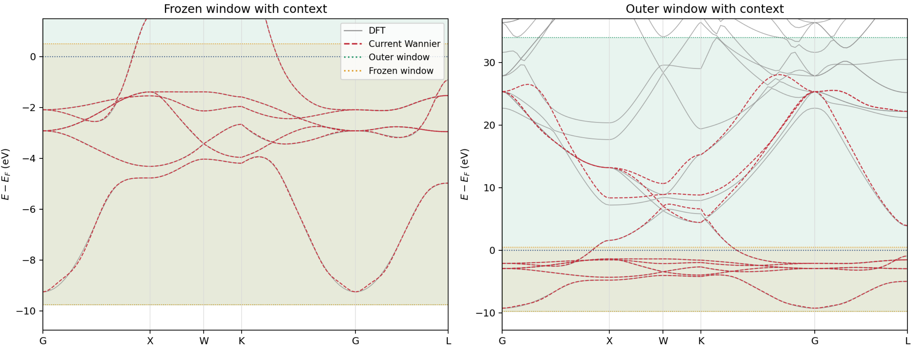

# About the Cu workflow illustration

[English project page](../README.en.md) · [Chinese illustration](CU-WORKFLOW-ILLUSTRATION.md)

Face-centered cubic copper (fcc Cu), for which beginners can encounter fitting difficulties, illustrates how AI agents use WannierCompass. The tests used **GPT-6.0sol (mid) in Codex**, **GLM-5.3flash (locally deployed) in OpenCode**, and **DeepSeek-v4.1flash (low) in DeepSeek Harness**. The initial input supplied only the toolkit path, POSCAR, the required VASP calculation settings, and program and execution paths. No additional instructions specified the basis, windows or retry strategy; the task was simply:

> Complete the DFT calculations and construct the Wannier TB Hamiltonian for fcc Cu.

The depicted `d+s` and `d+s+p` choices refer to orbital bases for the trial Wannier TB Hamiltonians. When a TB Hamiltonian built with the smaller basis misses relevant conduction states, adding `p` is one hypothesis to test. A different task or different evidence may support a smaller basis. Atomic projection character does not by itself require a matching extra projection in the Wannier basis.

The speech bubbles summarize decisions rather than reproduce a verbatim transcript. AI model, reasoning-mode and deployment labels follow the author's figure. Check marks indicate that no further calculation round was performed. Users can request further adjustments based on the accuracy and fitting range they need. The check marks do not certify arbitrary high conduction, the full Brillouin zone, symmetry or unspecified physical applications.

## A closer look at the frozen and dis windows

The left panel zooms in on the bands around the frozen window; the right panel shows the dis (outer) window and surrounding bands. Gray solid lines show DFT bands, and red dashed lines show Wannier-interpolated bands. Orange and green dotted lines mark the frozen and dis window boundaries, respectively.

