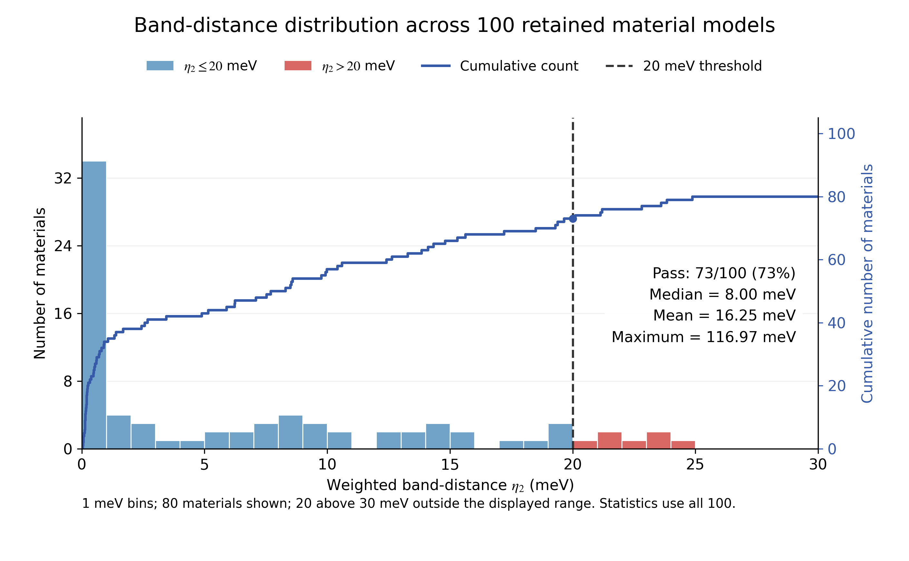
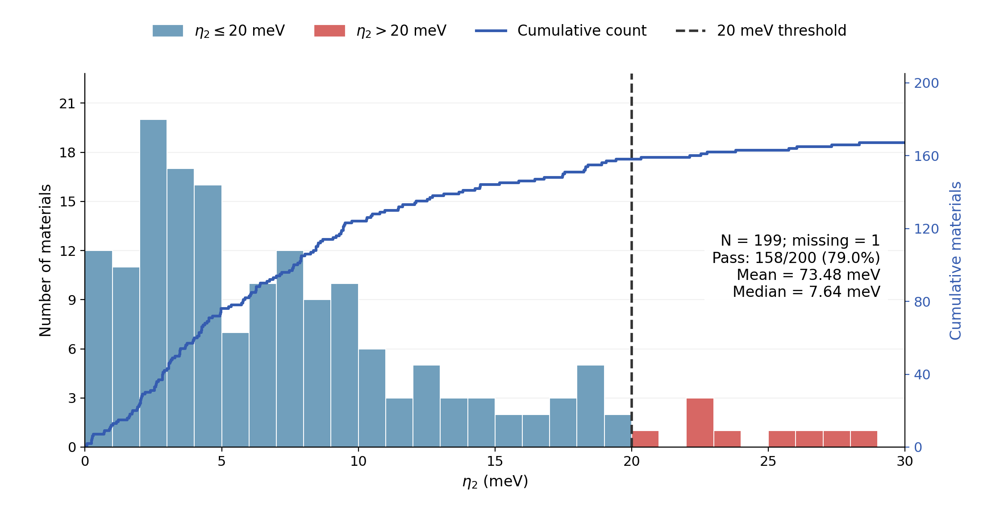
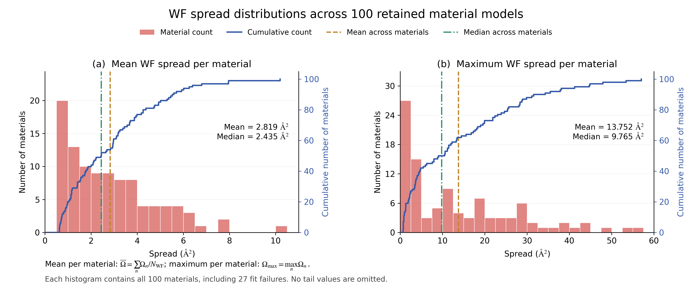
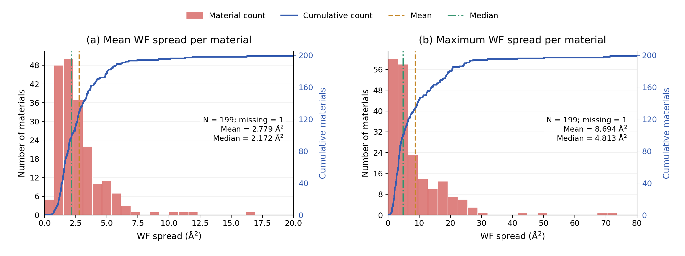
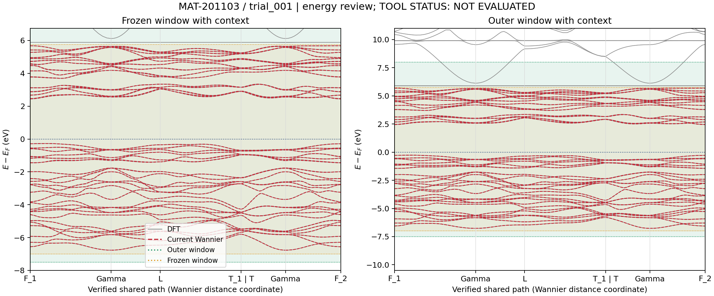
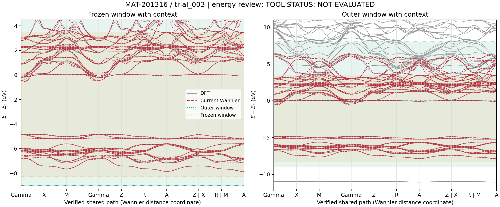
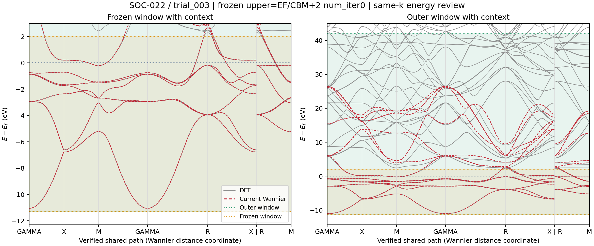
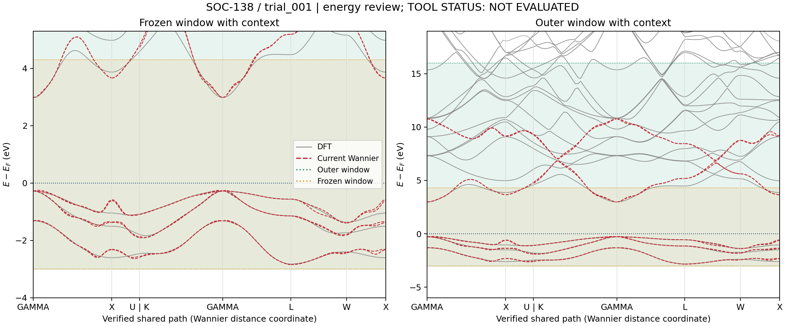

# Batch material tests: a 100-material set including magnetic compounds and a SOC200 literature comparison

[Back to the project](../../README.en.md#test-results-and-cost-comparison) · [简体中文](batch-material-tests.md)

These tests evaluate WannierCompass on batches of materials. The agent uses DFT projected bands to choose an orbital basis and energy windows, runs Wannier90, and reviews the band fit before deciding whether to adjust the model.

The two sets contain 100 materials, including magnetic compounds, and the 200 SOC structures released with the reference paper. Our calculations use VASP with standard PAW-PBE potentials and no additional hydrogenic projectors. The pass threshold is a weighted band distance η₂ ≤ 20 meV.

## Results

| Test set | Materials | Passed | Pass rate | Attempts, including initial runs | Mean per material |
|---|---:|---:|---:|---:|---:|
| 100-material set including magnetic compounds | 100 | 73 | 73.0% | 172 | 1.72 |
| Literature SOC200 set | 200 | 158 | 79.0% | 610 | 3.05 |

The 100-material set is deduplicated by reduced elemental composition and final-SCF magnetic space group, retaining different magnetic groups. SOC200 retains all 200 literature structures: 199 have valid scores; one terminated calculation is counted as a nonpass.

The first construction uses `num_iter=0`. Maximal localization is enabled later when needed, with a cap of 100 steps in this test. Localization runs with 20-, 50- and 100-step caps on the same material and baseline model count together as one attempt; a different baseline is counted separately. SOC200 has 461 non-localization attempts and 149 grouped localization attempts. The 100-material set retains its original total of 172 attempts.

## Comparison on the same SOC200 structure set

We use the [public structures from Jiang et al.](https://archive.materialscloud.org/records/fhp6p-vdm66), with independent VASP calculations and Wannier construction. The main comparison uses the two [paper](https://doi.org/10.1038/s41524-025-01835-8) settings without added hydrogenic projectors. It compares final pass rates and construction attempts. The paper uses Quantum ESPRESSO with two pseudopotential libraries; our test uses standard VASP PAW-PBE potentials.

| Method | Potential library | Total attempts, including initial runs | Mean per material | Passed | Pass rate |
|---|---|---:|---:|---:|---:|
| Paper, no added hydrogenic projectors | PseudoDojo | 1,699 | 8.495 | 152/200 | 76.0% |
| Paper, no added hydrogenic projectors | modified-pslibrary | 882 | 4.410 | 181/200 | 90.5% |
| **WannierCompass, no added hydrogenic projectors** | **VASP PAW-PBE** | **610** | **3.050** | **158/200** | **79.0%** |

WannierCompass reaches a 79.0% pass rate with 3.05 attempts per material. Its attempt count is 64.1% and 30.8% lower than the two paper settings without added projectors. Its pass rate is higher than the PseudoDojo setting and lower than the modified-pslibrary setting. Our test enables localization when needed, capped at 100 steps; the paper's public calculations use a 4000-step cap. Construction attempts are the measure of effort reported here.

With added hydrogenic projectors, the paper's PseudoDojo and modified-pslibrary settings reach 98.5% and 99.0%, with 323 and 281 total candidates. These results motivate further work on projector completeness.

Evaluation compares bands at the same k-points, up to EF + 2 eV for metals or the sampled CBM + 2 eV for insulators, with σ = 0.1 eV. Our η₂ uses Hungarian matching of the fixed target bands. The paper's total candidate counts include 200 initial runs plus the additional parameter-optimization attempts in its public records.

## Band-distance distributions

### 100-material set

### SOC200 set

Both plots display 0–30 meV. Means and medians use every valid score; the per-material CSV files contain the full values.

## Wannier spread distributions

For each material, we report the mean and maximum spread over its Wannier functions, in Ų.

### 100-material test set

### 200-material test set

The equal-material average of the mean WF spread over passing materials is 2.228 Ų and 2.524 Ų, respectively. The distributions above include every valid retained model.

## Band-fit examples

Two passing and two nonpassing cases are shown below. The η₂ values come from the unified review. Gray curves are DFT bands; red dashed curves are Wannier bands.

| Set | Material | η₂ (meV) | Result |
|---|---|---:|---|
| 100-material | Cr₂O₃ | 0.090 | Passed |
| 100-material | CsEuCl₃ | 36.060 | Not passed |
| SOC200 | AlCo | 13.119 | Passed |
| SOC200 | NaI (source formula INa) | 136.995 | Not passed |

Show band-fit figures

**Cr₂O₃**

**CsEuCl₃**

**AlCo**

**NaI**

## Downloads

| Set | Per-material results | Summary | Display package |
|---|---|---|---|
| 100-material | [results.csv](../../benchmarks/batch-material-tests/nano100/results.csv) | [comparison.csv](../../benchmarks/batch-material-tests/nano100/comparison.csv) · [summary.json](../../benchmarks/batch-material-tests/nano100/summary.json) | [nano100.zip](../../benchmarks/batch-material-tests/nano100.zip) |
| SOC200 | [results.csv](../../benchmarks/batch-material-tests/soc200/results.csv) | [comparison.csv](../../benchmarks/batch-material-tests/soc200/comparison.csv) · [summary.json](../../benchmarks/batch-material-tests/soc200/summary.json) | [soc200.zip](../../benchmarks/batch-material-tests/soc200.zip) |

SOC200's per-material attempt breakdown is in [attempt_counts.csv](../../benchmarks/batch-material-tests/soc200/attempt_counts.csv), with the definition in [attempt_accounting.json](../../benchmarks/batch-material-tests/soc200/attempt_accounting.json). Both sets provide the retained model's windows and spreads. Window bounds are in eV relative to the original SCF Fermi level.

The paper's four settings are in [paper_comparison.csv](../../benchmarks/batch-material-tests/paper_comparison.csv); the page summary is in [summary.json](../../benchmarks/batch-material-tests/summary.json).

## Discussion and implications

The comprehensive work by Jiang et al. offers an important insight: the atomic-orbital projector set supplied by a conventional pseudopotential may not adequately span the target bands in some systems. Adding hydrogenic projectors is therefore more than a way to improve automated success rates; in some cases, it may be necessary to obtain a high-quality Wannier model.

The current version of WannierCompass can reduce construction attempts and improve automation, but orbital and window selection remain limited by the available projector basis. Approximately 20% of the materials in our SOC200 test still did not pass the current evaluation, showing that these choices alone have not resolved Wannier construction for every material. This important work reminds us to consider the key role of completing the projection space in ultimately improving the robustness of Wannier construction.

## Sources

- Y. Jiang et al., *Robust Wannierization including magnetization and spin-orbit coupling via projectability disentanglement*, npj Computational Materials **11**, 353 (2025). [Paper](https://doi.org/10.1038/s41524-025-01835-8)
- [Materials Cloud dataset, version 2](https://archive.materialscloud.org/records/fhp6p-vdm66): SOC200 structure source.
- [Historical public parameter-candidate archive](https://archive.materialscloud.org/records/tc8pz-ddy75): its four candidate totals agree with the additional optimization counts on page 6 of the paper.
