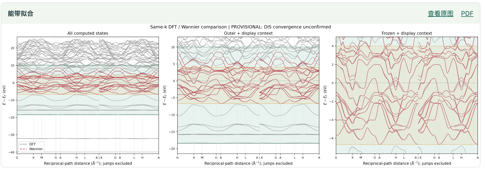

**[简体中文](QUICKSTART.md) · [English →](QUICKSTART.en.md)**

# Small-model workflow: quick start

**Using a locally deployed model as an example (Qwen 3.5-122b @ 4x RTX 4090), this guide introduces specialized roles, structured plans and handoffs.**

We want locally deployable small models to perform automated Wannier construction too. To work with their capabilities, this workflow divides complex tasks into clearly defined roles and uses structured plans and handoffs, reducing the number of issues each step must handle at once.

[Install](#install) · [Configure](#config) · [Material inputs](#input) · [Run](#run) · [Results](#output) · [Example image](#example)

Requirements: Python 3.10+, an OpenAI-compatible model API, VASP and Wannier90.

<a id="install"></a>

## 1. Download and install

```bash
git clone https://github.com/isinglch/wannier-compass.git
cd wannier-compass/extensions/small-model

python3 -m venv .venv
source .venv/bin/activate
python -m pip install .
python agent --help
```

Run the following commands from `extensions/small-model` using the same Python environment.

<a id="config"></a>

## 2. Configure the model and calculation programs

Copy the configuration template, then edit `agent.local.json`:

```bash
cp agent.json agent.local.json
```

| Setting | What to enter |
|---|---|
| `models.default.base_url` | Model API address, for example `http://127.0.0.1:8000/v1` |
| `models.default.model` | Model ID supplied by the model service |
| `execution.vasp` | VASP command array, for example `["/path/to/vasp_std"]` |
| `execution.wannier90` | Wannier90 command array, for example `["/path/to/wannier90.x"]` |
| `execution.mesh_grid` | Interface calculation mesh, for example `[8, 8, 1]` for a two-dimensional material |
| `max_trials` | Maximum trial count; the template uses `3` |

For SOC materials, use the appropriate `vasp_ncl` command. Include MPI launch arguments in the command arrays.

<details>
<summary>Model authentication, context and other settings</summary>

If the API requires a key, copy `.env.example` to `.env` and fill in `MODEL_API_KEY`:

```bash
cp .env.example .env
```

Set `models.default.context_tokens` and `models.default.max_tokens` for your model service. The program automatically reads the complete `agent.local.json`; use `--config` to select another configuration file.

</details>

<a id="input"></a>

## 3. Prepare the material directory

Place the completed SCF and projected-band data in one material directory:

```text
CASE/
├── 01_scf/
│   └── INCAR  POSCAR  POTCAR  CHGCAR  OUTCAR
└── 02_band/
    └── INCAR  POSCAR  POTCAR  KPOINTS  EIGENVAL  PROCAR  charge.npz
```

`charge.npz` is the cache generated from the current projected-band data.

<details>
<summary>First use: generate charge.npz</summary>

```bash
python agent cache --poscar /ABS/CASE/02_band/POSCAR --eigenval /ABS/CASE/02_band/EIGENVAL --procar /ABS/CASE/02_band/PROCAR --kpoints /ABS/CASE/02_band/KPOINTS --scf-outcar /ABS/CASE/01_scf/OUTCAR --sampling band_path --out /ABS/CASE/02_band/charge.npz
```

Replace `/ABS/CASE` with the material directory's absolute path.

</details>

<a id="run"></a>

## 4. Check and run

```bash
python agent check /ABS/CASE
python agent run /ABS/CASE
```

`check` inspects the local environment and executable configuration. `run` starts planning, review, calculation and evaluation.

<details>
<summary>Review a plan first, or choose an output directory</summary>

Generate and review a plan:

```bash
python agent run /ABS/CASE --review-only
```

Choose where results are saved:

```bash
python agent run /ABS/CASE --runs-root /ABS/OUTPUT
```

</details>

<a id="output"></a>

## 5. View progress and results

View the run:

```bash
python agent view
```

Results are saved by default in `runs/<run-id>/`:

| File or directory | Contents |
|---|---|
| `final-report.json` | Run summary and role conclusions |
| `plans/` | Plans and review records |
| `trials/` | Trial inputs, outputs and fitting results |
| `plots/index.html` | Band and plan image index |

<a id="example"></a>

## Example image



DFT / Wannier band comparison from the workflow output.

[← WannierCompass project homepage](../../README.en.md)
