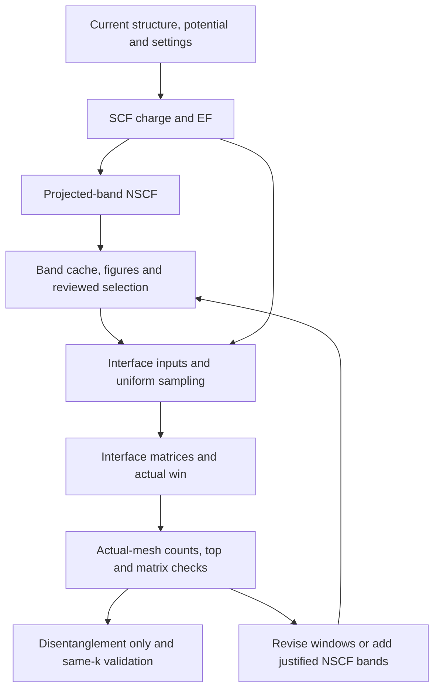

# Preparing DFT evidence for Wannier construction

`tools/dft_workflow.py` prepares material-independent inputs, scheduler scripts, run checks, and caches. SCF charge supports projected-band and interface non-self-consistent calculations. Historical bases/windows, Berry tasks, and material-specific parameters are not inherited.



Default preparation/submission covers scf and band. Interface matrix generation itself requires uniform sampling; this is not an extra selection/DOS step. Independent mesh is optional and explicitly selected, including reusable shared-wave preparation. Missing mesh cache/WAVECAR does not block the default interface route.

## Supported scope

Automatic generation supports static nonmagnetic PAW LDA/GGA at the same scalar or SOC Hamiltonian. Preserve structure, potentials, XC/charge, spin convention, and density source across stages. Callers supply production inputs; the tool does not choose potential versions, inherit successful INCAR, impose universal ENCUT factors, guess high-symmetry paths, or treat all 2D cases as 3D.

DFT+U, meta-GGA, hybrids, collinear magnetic dual channels, and special density protocols need separately reviewed adapters. Scalar-density SOC restart is physically possible but not automatically supported here; it also requires an energy reference matching the SOC uniform-grid Hamiltonian rather than scalar EF. See [LNONCOLLINEAR](https://vasp.at/wiki/LNONCOLLINEAR) and [EFERMI](https://vasp.at/wiki/EFERMI).

## 1. Inputs and resources

The settings example defines format only, not recommended convergence parameters:

```json
{
  "case_id": "case-0001",
  "spin_mode": "spinor",
  "settings_reason": "Current evidence for cutoff, sampling, occupation and spin settings",
  "common_incar": {
    "ENCUT": 500,
    "EDIFF": 1e-6,
    "ISMEAR": 0,
    "SIGMA": 0.05,
    "LMAXMIX": 4,
    "PREC": "Accurate",
    "ALGO": "Normal",
    "NELM": 160,
    "GGA": "PE"
  },
  "nbands": {"mode": "double_default_estimate"},
  "scf_mesh": [6, 6, 6],
  "wannier_mesh": [6, 6, 6],
  "band_path": {
    "reason": "Current-cell symmetry and coverage; do not copy this example",
    "points_per_segment": 40,
    "segments": [
      {"start": [0, 0, 0], "end": [0.5, 0, 0], "start_label": "G", "end_label": "X"}
    ]
  }
}
```

Scalar uses vasp_std; spinor uses vasp_ncl, with nonmagnetic starting moments sized to actual atoms. The caller specifies 2D vacuum-direction sampling. Set LMAXMIX before generating charge: potential-dependent retained angular components commonly require 2/4/6 for s-p/d/f fixed-density work; this does not select the Wannier basis. See [ICHARG](https://vasp.at/wiki/ICHARG). Preparation is not ENCUT/grid convergence evidence.

| NBANDS mode | Interpretation |
| --- | --- |
| double_default_estimate | Estimate nonmagnetic default from NELECT/atoms/spinor factor and double it; not an exact claim for all VASP builds/parallel layouts |
| explicit with value | Current user/agent choice |
| double_reference with reference_bands/reason | Double a sourced reference estimate |
| shell_reserve with empty_electron_slots_per_atom | Explicit per-element valence filling reserve; convert 2 slots per scalar band or 1 per spinor band and add to estimated baseline; do not infer target shells from POTCAR |

Record requested and actual OUTCAR/EIGENVAL bands: VASP may round for parallelism. Added empty states still need sufficient electronic iterations. See [NBANDS](https://vasp.at/wiki/NBANDS). Repeated tests reuse sufficient current data. Fix physical outer before separating path-projection and interface-wave deficits; poor fit alone does not establish NBANDS insufficiency.

Copy and adapt the [site template](../sites/slurm.example.json) for executables, partition, launch, initialization, and resource limits:

```bash
python tools/dft_workflow.py preflight --site sites/slurm.example.json
python tools/dft_workflow.py prepare \
  --poscar input/POSCAR --potcar input/POTCAR \
  --settings settings.json --out runs/case-0001
```

Preparation checks POTCAR species order/ZVAL/ENMAX against POSCAR and creates 01_scf, 02_band, 03_wan_trial, READMEs, case.json, and MATERIAL-LAYOUT.json. Inputs/outputs live directly in 01/02 for fresh DFT; Wannier trials are independent numbered children. CLI stages remain scf/band/mesh; case.json.stage_directories maps them to 01_scf/02_band/_optional_mesh. Older unmapped manifests retain old paths without moving outputs. wannier_mesh defines later interface sampling; only explicit mesh-stage selection creates/submits _optional_mesh. User-supplied licensed POTCAR is not distributed. Existing destinations are rejected; preparation does not compute.

## 2. Execution and collection

```bash
# Preview only.
python tools/dft_workflow.py submit --case runs/case-0001 \
  --site sites/slurm.example.json --stages scf band

# Submit within current authorization.
python tools/dft_workflow.py submit --case runs/case-0001 \
  --site sites/slurm.example.json --stages scf band --execute

python tools/dft_workflow.py inspect --case runs/case-0001 --stage band
python tools/dft_workflow.py collect --case runs/case-0001 --stage band
# Collection already generates official DFT and element-by-spdf figures.
python tools/plot_review.py --cache runs/case-0001/02_band/charge.npz \
  --out-dir runs/case-0001/02_band/review
```

Scripts use run-stage sequentially and stop downstream on failure. Slurm profiles require allocation; local profiles are only for explicitly authorized local/synthetic work. Initialize the environment explicitly. SCF starts ISTART=0/ICHARG=2 and saves CHGCAR. Bands/default interface use that charge with ICHARG=11; default interface uses ISTART=0/LWAVE=false. Automatic Gamma/Monkhorst sampling and ISYM=-1 provide interface input; verify VASP actual points/order/energies afterward. ISYM=0 is not a full-grid guarantee; see [ISYM](https://vasp.at/wiki/ISYM).

VASP Wannier/PEAD uses automatic-grid input. A verifiable complete explicit Gamma grid may be converted to equivalent automatic KPOINTS in a new interface, preserving dimensions/origin and source files. No extra mesh run, unknown-order WAVECAR reuse, or unnecessary band rerun is required.

For tetrahedron ISMEAR=-4/-5/-14/-15 in common settings, projected-path bands explicitly use ISMEAR=0, since path points do not form the integration grid. Retain the same SCF charge; record integration protocols separately. The energy reference stays SCF EF, not line-path EF.

Inspect checks normal exit, EDIFF convergence, NSW=0, sampling/bands, and run hashes. Zero return, nonempty files, or ionic accuracy messages alone are insufficient. Charge-copy failure is an error. Collect must still parse complete PROCAR/EIGENVAL; run checks do not establish grid/cutoff convergence or fit.

Band collect writes the [cache](VASP-CACHE.md), fit_path, and automatically invokes [DFT plotting](DFT-PLOTS.md). In 02_band/plots, retain dft_bands.png/pdf, projected_bands.png/pdf, and manifest, with root relative links. Default figures cover all computed energies on raw absolute projection scales. Explicit supplementary ranges or frozen/outer context views are allowed; there is no fixed EF seed.

Reuse also requires figures. Collect rechecks cache-bound POSCAR/EIGENVAL/PROCAR/KPOINTS/SCF EF, reuses valid caches without overwrite, generates missing plots, or verifies existing manifests/hashes. Source mismatch, modified figures, or conflicting root files are errors retaining evidence. Plotting is not Wannier acceptance or an additional dense-DOS requirement.

## 3. Additional bands and interface preparation

Reuse SCF only with unchanged charge-related Hamiltonian and structure:

```bash
python tools/dft_workflow.py prepare \
  --poscar input/POSCAR --potcar input/POTCAR \
  --settings settings_more_bands.json --out runs/case-0001-more-bands \
  --reuse-scf-case runs/case-0001
```

Validate/copy original SCF and execute only required later steps in a fresh case. Preserve old trials. Legacy/new paths are resolved by manifests: keep the original run record as run.reused-source.json and use a separate current run.json with provenance/input binding and new_execution=false. Changed density physics cannot use this route. Missing a tail heuristic alone does not trigger more bands.

After reviewed selection, [interface preparation](WANNIER-INTERFACE.md) generates win.in and embedded WANNIER90_WIN; VASP generates actual win. Initial DFT disables LWANNIER90/LWANNIER90_RUN and contains no historical basis/window. Interface generation does not run DIS/localization. Require explicit num_iter=0, DIS default/cap 10000, tol 1e-8/window 3, and the 2000-step slow marker. Missing/nonzero localization controls are rejected. AMN depends on projections; MMN/EIG depend on band space/grid. Changed inputs need matching matrices, not text-only updates.

This DFT CLI does not optimize structures, choose paths, or prove empty-state completeness. The package MCP adapter wraps its explicit actions. Historical-access isolation remains the [evaluation environment's](EVALUATION-AND-KNOWLEDGE.md) responsibility.
