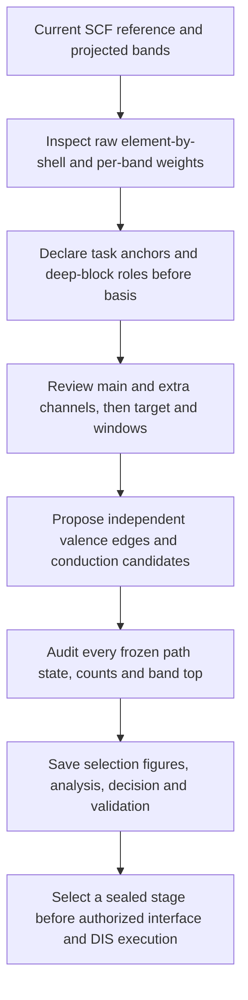

# Complete-manifold selection without execution

The [canonical decision sequence](WORKFLOW-DECISIONS.md) defines scientific order and priority. This reference specifies tool inputs, outputs, and execution gates; it adds no competing selection rules.

Follow [decision stages](DECISION-STAGES.md): standalone `propose` creates a draft; new execution binds a sealed first try/retry. Initial is not directly executable. `tools/manifold_selection.py` reads a completed projected band cache, requires no independent mesh/PDOS, and runs no VASP/W90/postw90 or scheduler. Its output is a trial proposal, not a validated model.

Read [physical reasoning](PHYSICAL-REASONING.md), generate the [review packet](INDEPENDENT-REVIEW.md), and inspect full-path figures/per-band CSV. After proposal, review diagnostics inspect weak target weight at every adopted frozen state, repeated explanations, contradictory statuses, and path counts. `frozen_upper_review` screens an earlier higher candidate and does not replace the adopted-window audit. Neither automatically changes windows or creates expansion evidence.

## Workflow and evidence



| Evidence | Tool use | Required interpretation |
| --- | --- | --- |
| Chemical starting basis | s-block s, d-block d, p-block p, available f-series f; additionally review nominally empty Ca/Sr/Ba d as a candidate | Confirm actual target role and any extension from projection evidence; f-series membership alone does not establish f occupation |
| Raw projections | Full-spectrum state/band distributions and same-state competition; no channel self-normalization | Review valence shells, blocks, hybridization, and objective without a fixed energy-width screen |
| Per-band evidence | Energy envelopes, mean/max channel weights, adjacent global gaps | Locate target and separate deep blocks of the same angular channel |
| `target_band_ranges_1based` | Outer preserves these rows' full sampled-path envelope | Rows are reviewed target/candidate states; not every background row requires full preservation |
| `reference_band_ranges_1based` | Widest row envelope: must contain every target row (nesting frozen ⊆ target ⊆ reference is mandatory); its conduction states with E−EF≥0 supply 70% quantile, 1 eV bins, and two-bin half-peak tail indicator | Determine decay, right censoring, or separate high-energy blocks; "reference" is a schema term for this envelope, not a physics reference band |
| `frozen_band_ranges_1based` | Subset envelope proposes inner edges, independently avoiding retained lower background | Identify clean protected states and mixed states left to DIS; a scalar window can also include parts of other rows |
| State counts | Atom counts, shell degeneracy, and spinor factor determine Nwann; count each k | Path counts are prechecks, not actual-interface certification |
| Additional candidates | EF+0.5 eV for metals/semimetals or CBM+0.5 eV for insulators; upper−0.5, lower±0.5, and outer-upper+2 eV probes with counts | These are reviewed starting/probe candidates, not automatic replacements or physical limits |

Indices are 1-based inclusive energy-ordered path rows, not connected wavefunction labels. If crossings cannot be expressed reliably by those rows, retain uncertainty. Gaps alone do not assign target membership. Outer candidate rows can exceed Nwann because DIS needs mixed states; this does not mean an Nwann-dimensional model can reproduce every candidate DFT branch simultaneously. Preserve the warning and define matching/acceptance according to model dimension, character, and task.


### v3 task scope and extra channels

Use the generated `review_workflow.py` template for the current cache. New proposals require `wannier-manifold-review-v3`; migrate an older draft by reviewing the new fields, not by adding orbitals to satisfy them. Archived v2 results remain historical records.

`task_scope_review` is declared before basis/target. `task_anchor_band_ranges_1based` identifies independently required task states; `deep_blocks` lists specifically concentrated lower blocks with `task_target`, `retained_background` or `outside_task` roles. It is not a list of all occupied rows. The default objective is `primary_task_manifold`; `explicitly_requested_extended_manifold` needs `requested_scope_evidence` from the actual broader request. A self-declared larger target does not constitute that request.

Final target rows retain all declared task-anchor rows and all deep blocks explicitly declared task_target. A feasible window cannot drop required task states to clear a gate.

Every `orbital_decisions` item gives `task_role`, `risk_if_included` and `risk_if_omitted` beside its existing reason. Roles are `task_component`, `exploratory_task_component`, `secondary_hybridization`, `deep_only` and `no_task_role`. Included unresolved components require exploratory trial intent; deep-only/no-task channels are omitted. Main chemical candidates are the block shell; optional empty-d hints are separate and impose no omission burden.

`additional_basis_evidence` contains exactly the included channels outside the main chemical basis. Each entry gives `witness_k_band_1based`, `representation_reason` and `independent_of_deep_block`. For the primary task, cite a raw task-anchor state outside declared deep blocks and explain the extra representation role or proposed exploratory comparison. Nonzero raw weight checks the coordinate only, not scientific necessity. No mathematical impossibility proof is required before trial. A requested extended model may cite its explicitly requested deep target, with independence false. Other deep-block roles cannot justify the extra channel.

These gates check evidence and scope consistency. They add no global-gap requirement for omission, no universal energy/weight cutoff, and no automatic basis recommendation. They change no frozen-counterexample logic. Keep task and core-target evaluation fixed after sealing; report additional deep-state fit separately when comparing bases.

## DFT-space assessment: physical outer first

`selection.json#/dft_space_assessment` and `numerical_checks.data_adequacy` use the same check. Preserve basis/exclusions/windows and report source, per-k counts/margins, and next action without automatically editing them. After interface generation, separately evaluate the actual interface EIGENVAL mesh with `data_scope=interface_wavefunctions`.

| Current data | Status/action | Review |
| --- | --- | --- |
| Physical dis_max touches/exceeds any k's last computed band, or all retained bands number fewer than Nwann | `needs_more_data` / `add_bands_nscf`, also in decision.json | Keep the justified window. Add path projections, interface waves, or both according to the actual missing source |
| Band top is sufficient but some k has Nouter<Nwann | `needs_outer_review` / `review_physical_outer` | Review physical outer and target/candidate space before inferring a need for more DFT bands |
| Nfrozen>Nwann | `needs_frozen_review` / `review_frozen` | Review inner independently; retain simultaneous DFT issues and justified outer |
| Numerical gate passes | `numeric_gate_pass_not_completeness` | Review continuation, censoring, Nouter−Nwann and top margin; equality leaves almost no DIS choice |

Small positive top margin may warrant review, with no universal 5/10 eV gate or default NBANDS. Poor fit, unclear tails, or incomplete atomic projections alone do not establish DFT insufficiency. High empty-band requirements are task-specific.

`policies/reference-v0.2.json` supplies initial outer margin 0.5 eV/outward rounding 0.25 eV, and frozen margin/rounding 0.05 eV. These are initial numerical conventions, not physical constants or per-material adjustments to reproduce history. The 70%/tail heuristic can raise an initial candidate but cannot cut reviewed target rows or compensate quantitatively for missing PROCAR weight. Retain window coverage and lower omissions. Path points are equally weighted and repeated endpoints retained; these spectra are not BZ DOS.

## Positive frozen proposals and negative screening

Propose frozen from target low-conduction roles and raw selected projections. Read reference-conditioned `upper_evidence` together with `upper_reference_audit`, which independently scans all computed bands and reports above-outer selected/unselected weights and crossing branches. High reference coverage does not establish shell completeness; nonzero outside-reference tails do not alone require expansion. Re-review target/reference/outer for target continuation; preserve uncertain roles in exploratory trials. The audit changes no basis/windows.

`frozen_expansion_evidence.candidates` reports added target/background counts, raw projections, and path counts. `path_positive_candidate=true` means worth reviewing, not automatic adoption. `frozen_edge_candidate` is a starting candidate. Review actual branches before the negative screen.

The **Frozen-state counterexample screen**, ID `frozen_state_counterexample_v1`, checks every retained state at every path k inside the adopted interval. `adopted_frozen_negative_screen` flags weak absolute selected projection and stronger omitted shells. `negative_samples`, `first_negative_energy_eV`, and `last_negative_energy_eV` identify witnesses. Lower witnesses prompt raising frozen_min; upper witnesses can veto a higher candidate or prompt lowering frozen_max. Interior witnesses require reviewing scalar-window feasibility. `possible_upper_shrink_eV` is an upper probe, not a remedy for lower witnesses. Nothing changes automatically.

| Criterion | Fixed prerequisites and position | Allowed effect | Outside scope |
| --- | --- | --- | --- |
| `frozen_state_counterexample_v1` | After basis, target/reference, exclusions, outer, and frozen candidate are independently specified | Review lower-edge increases or upper-edge veto/reduction from actual projection witnesses | Basis/target/exclusion/outer changes, frozen expansion, fit acceptance, or full-BZ claims |

`criterion_contracts/frozen_state_counterexample_v1` and diagnostics store this contract. Before introducing any criterion, register name/ID, stage, fixed inputs, allowed/prohibited variables, meaning of no trigger, and sampling limits. Verify invariance outside its scope. `no_negative_evidence_on_sampled_path` records only absence of sampled counterexamples. Higher frozen needs independent positive branch evidence. The 0.10 absolute indicator must be interpreted with atomic-projection limitations; counts `N_frozen≤N_wann≤N_outer` are separate gates.

Use reasoned `review.json.window_override`, re-propose, and screen the actual adopted interval. Before sealing first try/retry, run `conduction_review.py questions`, revise scientific choices first, and fill the latest answer_template. Re-propose after answering, generate fresh questions, and check. `selection.review_sha256` must match the final review. Coordinates, candidate-local witnesses, and explicit uncertainty are verified; physical identity remains under review. Initial stores questions but does not require answers.

## Commands and review contract

Create the [material layout](MATERIAL-LAYOUT.md). Selection-only trials have separate records and explicitly state that W90 has not run; do not fabricate HR or fit outputs.

```bash
python tools/manifold_selection.py inspect --cache CASE/02_band/charge.npz \
  --out CASE/03_wan_trial/trial_001/records/inspection.json

# Write review.json from current inspection and full projected-band figures.
python tools/manifold_selection.py propose --cache CASE/02_band/charge.npz \
  --path CASE/02_band/fit_path.json \
  --inspection CASE/03_wan_trial/trial_001/records/inspection.json \
  --review CASE/03_wan_trial/trial_001/records/review.json \
  --out-dir CASE/03_wan_trial/trial_001/records/selection
```

Required review fields follow. X, coordinates, and ranges are placeholders, not a runnable material answer:

```json
{
  "format": "wannier-manifold-review-v3",
  "inspection_id": "current-inspection-id",
  "basis_revision": "B1",
  "task_scope_review": {
    "format": "task-scope-review-v1",
    "objective_kind": "primary_task_manifold",
    "objective": "Physical task declared independently of basis and extra deep blocks",
    "requested_scope_evidence": null,
    "task_anchor_band_ranges_1based": [
      [
        2,
        3
      ]
    ],
    "deep_blocks": [
      {
        "band_range_1based": [
          1,
          1
        ],
        "orbital_groups": [
          "X:s"
        ],
        "role": "retained_background",
        "reason": "Current concentrated lower-block evidence"
      }
    ]
  },
  "orbital_decisions": [
    {
      "group": "X:s",
      "action": "omit_first_trial",
      "task_role": "deep_only",
      "reason": "Deep block has no independent remaining-task role",
      "risk_if_included": "Larger model and unrelated protected states",
      "risk_if_omitted": "Check remaining mixed task states"
    },
    {
      "group": "X:p",
      "action": "include",
      "task_role": "task_component",
      "reason": "Specific main task-valence and low-conduction evidence",
      "risk_if_included": "Check upper mixed candidates",
      "risk_if_omitted": "Lose required task branches"
    },
    {
      "group": "X:d",
      "action": "omit_first_trial",
      "task_role": "no_task_role",
      "reason": "Specific current raw evidence",
      "risk_if_included": "Unrequested higher block",
      "risk_if_omitted": "Check any residual task mixing"
    }
  ],
  "additional_basis_evidence": {},
  "target_band_ranges_1based": [
    [
      2,
      3
    ]
  ],
  "reference_band_ranges_1based": [
    [
      2,
      5
    ]
  ],
  "frozen_band_ranges_1based": [
    [
      2,
      2
    ]
  ],
  "reference_upper_status": "reviewed_decay",
  "target_reason": "Complete independently declared task, not every bonding shell",
  "reference_reason": "Tail evidence and separate upper blocks",
  "frozen_reason": "Clean protected subset; mixed background stays in DIS"
}
```

Review every available channel exactly once. Require frozen rows ⊆ target rows ⊆ reference rows. `reference_upper_status` also supports `right_censored`/`ambiguous`. A conservative initial may retain needs_window_review, followed by exploratory selection or justified data addition. A censored reference is distinct from an outer window exceeding the computed top.

Omitted `inspection.chemical_starting_basis` channels require `chemical_omission_evidence`: strongest reference raw-projection `(k,band)`, role, reason, and omission risk, with recomputed coordinates. If target low-conduction states lie above the frozen row-subset envelope, also supply `frozen_upper_decision` for its first unprotected state. Rounding/override can change the final scalar edge, so this witness may no longer be outside adopted frozen; `adopted_frozen_first_unprotected_target` reports the final-window witness separately.

```json
{
  "chemical_omission_evidence": {
    "X:p": {
      "peak_reference_k_band_1based": [1, 5],
      "physical_role": "secondary_hybridization",
      "reason": "Same-state competition at the peak and absence of independent target role",
      "risk_if_omitted": "Potential omitted targets and subsequent fit checks"
    }
  },
  "frozen_upper_decision": {
    "first_unprotected_target_k_band_1based": [1, 4],
    "disposition": "review_for_expansion",
    "reason": "Raw selected/unselected projections and reason for protection or deferral"
  }
}
```

Omit chemical omission evidence when none is omitted, and omit frozen_upper_decision when no eligible unprotected low-conduction state exists. Roles also include separate_non_target_block/no_target_role; disposition also allows defer_with_evidence. These fields establish explanation/evidence requirements, not physical acceptance. Selection records them alongside positive expansion evidence and negative review.

After rounding/override, inspect the final-window first unprotected target. An unchanged witness can reuse its reason; a new witness without explanation leaves `adopted_frozen_upper_review.resolved=false` and needs_window_review, while retaining a draft figure. Inspect its state/projection and re-propose in a fresh directory with:

```json
{
  "adopted_frozen_upper_decision": {
    "first_unprotected_target_k_band_1based": [1, 4],
    "disposition": "defer_with_evidence",
    "reason": "Current final-window witness and neighboring-branch evidence for this deferral"
  }
}
```

Coordinates are recomputed; do not copy examples. Explanation neither automatically expands frozen nor replaces the negative screen. Initial may retain unresolved issues; executable stages need an explicit explanation.

Outputs must include current inspection/review, selection, analysis, decision, validation, selection.png/pdf, and selection_plot_manifest.json. Selection retains edge evidence/candidates/warnings, num_iter=0, and unexecuted status. Propose copies inspection/review and uses the bundled official renderer, binding image hashes to choice. Standard layouts refresh the [gallery](SELECTION-GALLERY.md). Missing trustworthy path geometry is an error; JSON-only or custom SVG output is not completion. Explicit `--path` must match cache/hash/original KPOINTS/segments; otherwise use adapter-verified geometry embedded in the band cache. Blue lines denote target rows, red dashed lines outer, green frozen. Right-panel solid spectra use all computed conduction bands; dashed spectra use reference rows. Explain differences.

```bash
python tools/manifold_selection.py render --cache CASE/02_band/charge.npz \
  --selection OLD/selection.json --out-dir NEW/official_selection_plot
```

Rendering an existing choice does not reselect or overwrite it. render_manifest.json binds selection/cache/renderer/output hashes. Initial, first try, and retries retain their own PNG/PDF and stage checks. Selection-only work ends here. Later interface/W90 execution uses official entries, configured NSCF/shared waves, num_iter=0, four products, and same-k comparison.

Evaluators may compare history only after sealing current records; material-to-basis/window answers are not toolkit content. Row/block review still requires an agent/researcher; neither semantic branch automation nor real fitting is established by replay similarity.

## Occupied-prefix exclusions and conduction scope

Inspect supplies chemical candidates, occupations, `boundary_above` global/direct gaps with extremal k indices, and positive sampled global gaps. The global gap is next-row minimum minus preceding-row maximum, not minimum direct gap. occupied_prefix_candidates require occupation/gap margin but still need projection/target review.

```json
{
  "valence_exclusions": [
    {"band_range_1based": [1, 2], "orbital_groups": ["X:s"], "reason": "Current evidence for an occupied non-target block"}
  ],
  "conduction_groups": ["X:p"],
  "conduction_reason": "Selected channels belonging to conduction rather than only deep valence"
}
```

Absent valence_exclusions means none. Absent conduction_groups means all selected groups enter conduction diagnostics; explicit empty groups represent a valence model and need a reason. All declared target rows remain protected by outer.

Exclusions form a continuous low-energy prefix beginning at original band 1. Each reviewed block requires full occupation (spinor 1/scalar 2 per state; tolerance 0.001), sampled global gap at least 0.1 eV above, and no prohibited target/basis overlap. This margin is a conservative initial policy, not W90 mathematics or a physical constant; do not secretly retune it per material. Occupation/gap alone does not establish non-target character.

membership_kind absent or complete_shells checks atom-count×shell-degeneracy×spin capacity against band count. reviewed_spectral_block permits an explicitly reviewed block representing only part of an angular channel; it still requires orbital_groups, reason, occupations/gap/mapping checks. A separate deep radial shell of a selected angular channel is not automatically excluded by this version.

If the near-target boundary is unsafe, review deeper complete-block boundaries rather than assuming a fixed two-band retreat. Exclude only a safe deeper prefix, or none, retaining other background. This also applies to positive direct but negative global gaps. The tool lists candidates; the reviewer decides from projections. Global gaps do not establish orbital purity.

Choose dis_min below the complete target-valence envelope, then frozen_min from clean targets/retained background independently. protective_gap_candidate reports an optional midpoint with automatically_applied=false. Shared lower edges need explicit evidence and reasoned override. retained_lower_background reports retained rows/top/recommended inner lower edge; inspect other mixed/weak states through the negative screen. A valence global gap is not required to proceed.

decision.band_selection records original NBANDS, exclusions, retained original rows, matrix num_bands, and block reasons. Counts use retained states; target indices remain original. Interface preparation writes exclusions into WANNIER90_WIN without reducing VASP total NBANDS. Verify renumbered AMN/MMN/EIG against mapping, then occupations/gaps on full actual-interface EIGENVAL. Failure blocks DIS. exclusion_recovery.actual_interface_candidates supplies shorter prefixes/no-exclusion for review, not automatic replacement. Changing exclusions is a scientific revision requiring matching matrices; window-only changes may reuse them. Conduction 70% uses E−EF≥0 reference states and full-reference coverage is reported separately.

## Evidence tools and explicit reviewed overrides

Inspect has no default seed/priority interval. `--inspect-range EMIN EMAX` is optional supplementary diagnosis; `--seed` is a compatibility alias with no default. Otherwise inspect all computed states. scope.priority_window_eV defaults null; define priority separately from the physical task.

```json
{
  "window_override": {
    "dis_eV": [-6.2, 8.4],
    "frozen_eV": [-5.7, 2.7],
    "reason": "Format-only example; derive actual values from current blocks and objective"
  }
}
```

Preserve heuristic_windows_relative_eV and reviewed_window_override. Recompute consistency, nesting, target envelope, counts, and top checks; failed proposals are not executable. Reviewed overrides revise heuristics without bypassing necessary conditions.

## Exploratory trials under uncertainty

Within authorization, after sealed conservative initial, first try/retry can use:

```json
{"trial_intent": {"mode": "exploratory", "reason": "Current upper-role/tail uncertainty and why this candidate is worth testing"}}
```

Also provide a reasoned window_override. Right-censored/ambiguous reference, missing tail, and high-energy target samples above outer remain warnings. Preserve target/reference rows, manifold_checks.above_outer_states, and unresolved complete_on_sampled_path; execution is not completeness/fit approval. If only scientific uncertainty remains, execute within budget and use results for retries.

Lower target truncation, insufficient outer count, excessive frozen count, nonnested windows, computed-top truncation, and input/matrix inconsistency still require correction. Preserve basis and add required non-self-consistent data when NBANDS is insufficient. Actual-interface checks remain mandatory. Initial may retain trial_intent as non-executable hypothesis metadata. Explicit real_first_try selection and all executable gates remain required. Every retry cites the parent's actual result and records differences; matching matrices can be reused for window-only changes.
