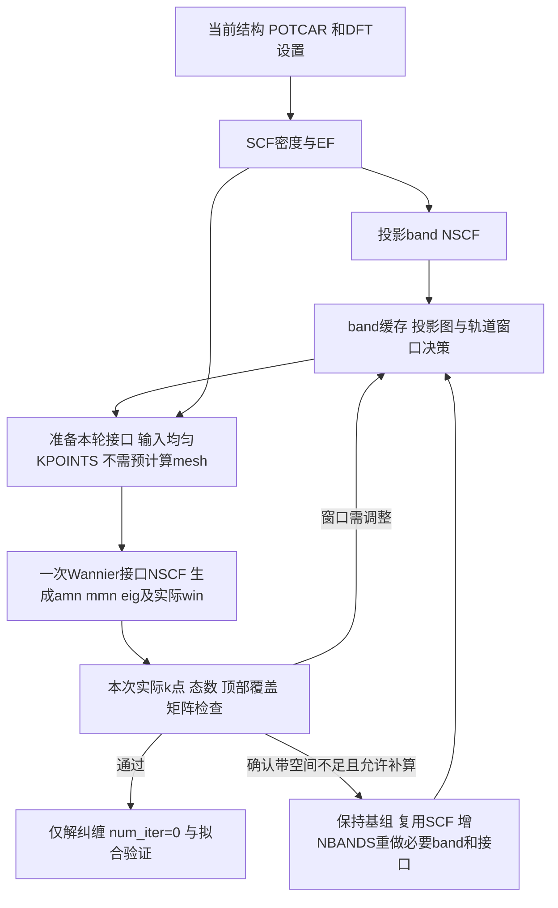

> 中文阅读译本；执行主版本： [English](../DFT-PREPARATION.md)。
> 对应英文来源 SHA256：`4514b9e45ee51d513bfd89137c915407de0f89a5109e22348203c552b8580049`。

# 为 Wannier 准备 DFT 素材

`tools/dft_workflow.py`提供材料无关的输入准备、Slurm脚本/提交、运行检查和缓存导出。旧流程可复用的部分是SCF密度驱动两类非自洽计算；旧基组、窗口、Berry任务和材料参数不进入这里。



默认DFT准备与提交只覆盖`scf`和`band`。Wannier接口自身需要均匀k采样，但这是生成矩阵的同一次NSCF，不是额外的轨道筛选/DOS步骤。独立`mesh`仅在明确要求时选择，不能因缺mesh cache或WAVECAR而阻止默认流程。

## 当前支持范围

自动生成器支持**静态、非磁性PAW LDA/GGA，同一scalar或SOC Hamiltonian**。结构、POTCAR、XC/电荷量、自旋约定和密度来源在SCF、band、mesh之间保持一致。生产输入由调用者明确提供，不自动选赝势版本、不复制历史成功INCAR、不统一强制ENCUT倍数，不自动猜高对称路径或把二维材料套三维网格。

DFT+U、meta-GGA、hybrid、磁性共线双通道、特殊密度协议需要另外审核的适配，目前不能静默写入这些设置。scalar密度用于SOC重启在物理和VASP层面可以成立，但本版自动路线没有实现该扩展；固定scalar密度的SOC计算还需要对应SOC均匀网格的能量参考，不能直接继承scalar EF。见[VASP非共线说明](https://vasp.at/wiki/LNONCOLLINEAR)及[EFERMI](https://vasp.at/wiki/EFERMI)。

## 1. 明确输入和资源配置

准备一份`settings.json`。下面数值**只说明格式**，不是任何材料的推荐收敛设置；调用AI应依据本次结构、赝势和计算目标审阅：

```json
{
  "case_id": "case-0001",
  "spin_mode": "spinor",
  "settings_reason": "填写本次ENCUT、积分网格、占据和自旋设置的依据",
  "common_incar": {
    "ENCUT": 500,
    "EDIFF": 1e-6,
    "ISMEAR": 0,
    "SIGMA": 0.05,
    "LMAXMIX": 4,
    "PREC": "Accurate",
    "ALGO": "Normal",
    "NELM": 160,
    "GGA": "PE"
  },
  "nbands": {"mode": "double_default_estimate"},
  "scf_mesh": [6, 6, 6],
  "wannier_mesh": [6, 6, 6],
  "band_path": {
    "reason": "填写当前晶胞中该路径的对称性/覆盖依据，勿照搬本例",
    "points_per_segment": 40,
    "segments": [
      {"start": [0, 0, 0], "end": [0.5, 0, 0], "start_label": "G", "end_label": "X"}
    ]
  }
}
```

`spin_mode=scalar`使用`vasp_std`，`spinor`使用`vasp_ncl`，当前均为非磁性起点。SOC的MAGMOM零项数按实际原子数写出。2D的真空方向网格由本次设置给出，不通过材料名称分支。

LMAXMIX必须在产出CHGCAR之前设置：需要保留的PAW角动量分量依赝势而定，固定密度计算通常按s/p、d、f分别考虑2、4、6；这不决定Wannier基组。参见[ICHARG](https://vasp.at/wiki/ICHARG)。ENCUT/POTCAR所需精度仍需要物理收敛证据，软件准备成功不代表收敛测试完成。

NBANDS预算支持：

| 模式 | 用途 |
|---|---|
| `double_default_estimate` | 缺省预算：根据NELECT、原子数和spinor因子估算VASP非磁默认值，再取两倍；不宣称等于每个编译版本/并行配置的真实默认值 |
| `explicit`，带`value` | 用户/AI明确给本次NBANDS |
| `double_reference`，带`reference_bands`、`reason` | 将已有可信默认/试探带数取两倍，说明来源 |
| `shell_reserve`，带`empty_electron_slots_per_atom` | 每种元素显式提供价层补满所需电子槽数，不从POTCAR猜目标轨道；换算为scalar每带2槽、spinor每带1槽后加到估计基准 |

保存请求值与实际OUTCAR/EIGENVAL值，不能假定VASP不会按并行设置上调。空带增加后仍需充分电子迭代。官方[NBANDS](https://vasp.at/wiki/NBANDS)说明了默认预算、自旋因子、并行上调及高端空态收敛问题。

已有 DFT 的重复测试默认复用当前数据，不把某次扩带计算的带数当作通用初始设置。先按物理目标确定 outer，再用[DFT 空间检查](MANIFOLD-SELECTION.md)区分投影路径缺口与接口波函数缺口，只补必要的非自洽步骤。拟合不通过并不单独证明 NBANDS 不足。

站点信息独立于科学设置。复制[示例 Slurm 配置](../../sites/slurm.example.json)后填写本机的可执行文件、分区、并行方式和资源预算；示例路径不能直接用于计算。运行 `preflight` 核对实际环境。

```bash
python tools/dft_workflow.py preflight --site sites/slurm.example.json
python tools/dft_workflow.py prepare \
  --poscar input/POSCAR --potcar input/POTCAR \
  --settings settings.json --out runs/case-0001
```

准备会检查POTCAR元素顺序、ZVAL/ENMAX元数据与POSCAR，默认创建`01_scf/`、`02_band/`、`03_wan_trial/`及统一README、`case.json`与`MATERIAL-LAYOUT.json`。真正的新DFT计算和复用素材采用相同编号入口；前两阶段的输入/输出直接放在`01_scf/`、`02_band/`，逐次Wannier计算归入`03_wan_trial/trial_001/`等新试次目录。见[材料目录规范](MATERIAL-LAYOUT.md)。

CLI阶段名仍为`scf`、`band`、`mesh`；`case.json.stage_directories`把语义名映射为`01_scf`、`02_band`、`_optional_mesh`。没有该映射的旧manifest仍按原`scf/`、`band/`、`mesh/`解析，无需挪动历史输出。`wannier_mesh`设置是后续接口的采样定义，不表示必须先执行独立mesh；只有显式选择额外mesh阶段才创建/提交`_optional_mesh/`。POTCAR由用户合法提供，不随包分发。已有目录拒绝覆盖，准备不执行计算。

## 2. 执行、检查和后处理

```bash
# 返回具体Slurm脚本文本，不调用sbatch。
python tools/dft_workflow.py submit --case runs/case-0001 \
  --site sites/slurm.example.json --stages scf band

# 只有实际要提交且处于本轮授权范围内时才加 --execute。
python tools/dft_workflow.py submit --case runs/case-0001 \
  --site sites/slurm.example.json --stages scf band --execute

# 上一个作业完成后。
python tools/dft_workflow.py inspect --case runs/case-0001 --stage band
python tools/dft_workflow.py collect --case runs/case-0001 --stage band
# collect 已自动生成DFT能带和全部元素×spdf投影图。
# 如另需路径投影谱/竞争细节，可在新目录追加诊断图。
python tools/plot_review.py --cache runs/case-0001/02_band/charge.npz \
  --out-dir runs/case-0001/02_band/review

```

Slurm脚本调用`run-stage`，按阶段顺序执行，任何一步失败停止下游。不在Slurm分配内时拒绝使用该站点配置启动VASP；`local`配置仅供明确的本地运行或合成测试。环境显式初始化，不沿用旧脚本的无后续加载的`module purge`。

SCF从原子密度开始（ISTART=0、ICHARG=2），保存CHGCAR；投影band与随后接口均使用同一密度、ICHARG=11。默认接口ISTART=0、LWAVE=false，不读取或写出大型WAVECAR。接口使用自动Gamma/Monkhorst KPOINTS与ISYM=-1；实际完整点集、顺序和本征值在接口结束后核验，不从Python预先枚举的顺序冒充VASP输出。ISYM=0不能替代完整网格保证，参见[ISYM](https://vasp.at/wiki/ISYM)。

VASP Wannier/PEAD要求自动网格输入。若用户提供的是完整显式Gamma网格，可在新接口目录中依据经核对的网格尺寸/原点生成等价自动KPOINTS并记录转换；不修改原文件，不需要先重做独立mesh，也不复用未知k序的WAVECAR。已验证band素材不因输入格式转换而重算。独立mesh旧入口仅用于已有数据兼容或另行明确授权的用途。

若公共设置使用四面体占据（ISMEAR=-4/-5/-14/-15），路径band阶段显式改为ISMEAR=0，因为路径点不是四面体积分网格；密度仍固定为同一个SCF CHGCAR，SCF和接口的积分协议另行记录并保持物理一致。实际生成INCAR随case保存，能量零点仍来自SCF，不取路径计算的EF。

`inspect`需要正常结束、电子EDIFF收敛标记、静态NSW=0、带数/路径/网格一致及运行记录哈希。不把进程退出0、文件非空或离子“reached required accuracy”单独视作成功。SCF密度复制失败直接报错。仍需`collect`完整解析PROCAR/EIGENVAL；必要运行检查通过不等于原始数值完整性、截断能/网格收敛或Wannier验收通过。

导出的`02_band/charge.npz`、`02_band/fit_path.json`使用[统一缓存接口](VASP-CACHE.md)，保留原始电荷权重、实际带数与SCF EF，可直接进入现有[判定工具](REFERENCE-TOOLS.md)。`collect --stage band`随后**自动**调用[DFT能带绘图](DFT-PLOTS.md)，在`02_band/plots/`生成`dft_bands.png/pdf`、`projected_bands.png/pdf`和来源manifest，并在`02_band/`根目录建立这四张图的相对链接。图默认包含全已算能区，采用同一绝对原始投影尺度；AI可明确追加诊断范围，已有窗口时可追加frozen/outer上下文视图。没有固定EF种子。

复用已有DFT/cache仍需有图：重复`collect`会先核对cache所绑定的POSCAR、EIGENVAL、PROCAR、KPOINTS和SCF EF来源；有效cache不会重算或覆盖。若尚无图则补画，若已有图则核对其manifest和图片哈希后复用。来源不匹配、图已被修改或根目录有冲突文件时明确报错，保留原证据。这个流程不额外强制一轮致密DOS计算，也不把作图完成当作Wannier验收通过。

## 3. 补NBANDS与后续接口

仅在密度、Hamiltonian和结构不变时复用SCF：

```bash
python tools/dft_workflow.py prepare \
  --poscar input/POSCAR --potcar input/POTCAR \
  --settings settings_more_bands.json --out runs/case-0001-more-bands \
  --reuse-scf-case runs/case-0001
```

此命令核对原SCF输出与来源并复制已验证SCF；新目录仅需执行必要的band与Wannier接口NSCF，旧尝试保留。旧`scf/`与新`01_scf/`之间可按manifest复用：原执行记录逐字保存为新目录的`01_scf/run.reused-source.json`，单独的`run.json`记录来源及当前目录的输入绑定，并明确`new_execution=false`；不会把搬运记录伪装成重新运行SCF。改变密度相关物理设置不能沿用这条补带路径；不因窗口尾部启发式未达线就自动加NBANDS。

band轨道/窗口决策完成后、实际mesh检查尚待本次接口时，按[Wannier接口准备](WANNIER-INTERFACE.md)生成本轮`wannier90.win.in`审阅内容和INCAR内嵌WANNIER90_WIN；实际`wannier90.win`由这次VASP接口生成，准备期不预建。DFT初始阶段始终关闭LWANNIER90/LWANNIER90_RUN，不带旧轨道/窗口；后续文件接口也只生成素材，不执行解纠缠或最局域化。审阅内容和实际`.win`均显式固定`num_iter=0`，禁止最局域化；独立的`dis_num_iter`默认且最多10000，可通过接口prepare的`--dis-num-iter`降低；显式设置`dis_conv_tol=1e-8`、`dis_conv_window=3`，2000步未收敛由执行检查额外标记。输入、输出检查拒绝缺失或非零`num_iter`，拟合失败不能触发开启最局域化。`.amn`依赖投影、`.mmn/.eig`依赖带空间和网格，变更这些输入需要重新生成匹配素材，不能只改文本假装旧矩阵已经更新。

DFT CLI 不执行结构优化、不决定高对称路径、不自动证明空带完备。本包 MCP 调用层封装这些明确输入/输出的动作；能否读取历史资料仍由[评测环境](EVALUATION-AND-KNOWLEDGE.md)实际隔离。
