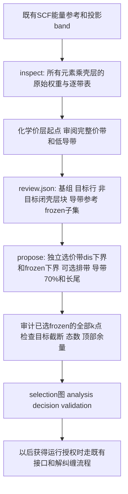

> 中文阅读译本；执行主版本： [English](../MANIFOLD-SELECTION.md)。

本版基组判定采用 v3：先声明物理任务锚点与集中的深谱块，再决定主 p/d/s 及额外通道。额外通道需有任务相关证据；不能先扩充深成键目标再用“完整性”要求加轨道。每个通道记录纳入与省略风险，无法确定时可显式探索。深背景无全局隙也可不加入基组，留在 dis 并独立提高 frozen 下沿。广泛深成键模型需要明确用户请求。字段和实际门槛以相邻英文规范的 v3 节为准。
> 对应英文来源 SHA256：`6fe609ac1b3e0d1fd794c17acc5e0a7f0430bce62ef18281abbd74ea6a71c47d`。

# 完整带组优先：只选择、不运行计算

科学选择的唯一顺序与优先级见 [WORKFLOW-DECISIONS.md](WORKFLOW-DECISIONS.md)。本文只说明工具输入、输出和必要门槛；与决策主文档重复的旧说明不另立规则。

执行阶段以[initial与real_first_try](DECISION-STAGES.md)为准：独立propose只作草稿；新执行必须绑定封存的real_first_try/retry。initial不直接执行，旧结果仍可只读核查。

入口 `tools/manifold_selection.py` 只读已完成的投影band缓存。无需独立mesh或PDOS，不执行VASP、Wannier90、postw90，也不提交作业。选择输出是**试算提案**，不是已验证模型。

先读[物理判断简述](PHYSICAL-REASONING.md)：化学价层作为候选起点，价带去非目标完整块，导带看延伸与尾部。重点精度区由当前物理任务明确，不设置固定EF种子。

独立选择先按[证据包与复核协议](INDEPENDENT-REVIEW.md)运行 `review_packet.py`，看全路径DFT/投影图和逐带CSV。`propose`后运行 `review_diagnostics.py`：它对**已采用**的frozen区也逐k检查弱目标投影，另外标出重复理由、状态文字矛盾和路径计数失败。`frozen_upper_review`对原有较高候选做负面筛查，不能代替当前窗口审计；两者均不自动改窗，更不能因筛查通过而扩大。这个判据的正式名称与决策边界见下表。

## 工作次序



| 依据 | 工具怎么用 | AI需要审阅什么 |
|---|---|---|
| 化学最小检查起点 | s区先看s，d区先看d，p区先看p；**Ba额外先看d**（原子半径大，名义空的5d态易靠近EF）；默认候选起点，保留可解释修订 | 真实投影是否支持该通道，是否需扩展 |
| 完整原始投影 | 默认全谱逐态值、逐带分布和同态比较；绝不自身归一化 | AI按价层、完整谱块、杂化与目标范围作判断，不用固定能量宽度筛选 |
| 全谱逐带证据 | 每个能量序号的上下界、各组均值/最大值、相邻全局能隙 | 目标块在哪里；深层同角动量峰是否属于独立非目标块 |
| `target_band_ranges_1based` | outer必须包含这些行在全部所采路径上的完整能量包络 | 这些行确实属于必须完整保留的目标主体；并非所有背景带都要完整收入 |
| `reference_band_ranges_1based` | 在明确参考集合的E−EF≥0部分按导带目标组计算70%能量点、1 eV谱箱和两箱半峰尾部提示 | 参考域是否已到主体衰减，还是碰到最后计算带、存在新高能谱块 |
| `frozen_band_ranges_1based` | 从该子集包络提出内窗，并独立避开保留的低端背景；不会因为找到排带隙而自动与outer共用下界 | 哪些目标应先冻结，哪些混合态先解纠缠；scalar内窗可能也纳入其它行的一部分 |
| 态数 | 从原子数、完整壳层及spinor因子计算Nwann；逐k计数 | 路径结果仅为预检查，不能宣布实际接口mesh已通过 |
| 后续候选 | frozen起步上界：金属/半金属EF+0.5 eV，绝缘体CBM+0.5 eV；另保留上界−0.5、下界±0.5 eV局部探针及outer上界+2 eV候选，各自附计数 | 起步候选不是最终上限，也不自动替换已有窗口；根据投影和真实拟合审阅 |

带号为**从1开始、闭区间、按能量排序的路径行**，不是跨交叉的波函数连通标识。这是保守、可复算的带组包络。交叉复杂到无法用这些行表达目标时，保留待审阅，不伪造自动连通结论。能隙只作旁证，不因一个隙就指定目标。

这里要求outer保留的行可以含有解纠缠需要的额外混合态，其数目可能大于Nwann；这不等于声称Nwann个模型态能同时逐条拟合更多DFT带。程序会对此单列警告。真正的拟合目标与误差匹配仍须按模型维数、成分和验收范围定义，不能用所有输入候选行直接要求一一对应。

### DFT 空间检查：先固定物理 outer，再分流

`selection.json#/dft_space_assessment` 与 `numerical_checks.data_adequacy` 使用同一检查。它保留基组、排带及两个窗口，报告当前数据来源、逐 k 态数/余量和下一步；不根据结果自动改窗或增带。接口完成后，同一诊断另用**本次接口 EIGENVAL 网格**计算，`data_scope=interface_wavefunctions`，不能拿路径结论代替它。

| 当前数据的事实 | 工具状态与行动 | AI 后续工作 |
|---|---|---|
| 已定 `dis_max` 触及/超过任一 k 的最后计算带，或全部保留带数仍少于 Nwann | `needs_more_data` / `add_bands_nscf`；路径提案的 `decision.json` 同步输出这两个值 | 保留有依据的窗口，补对应的非自洽数据。缺投影路径就补路径；缺接口波函数就补网格；两者都缺才都补。 |
| 带顶没有被触及，但部分 k 的 Nouter<Nwann | `needs_outer_review` / `review_physical_outer` | 先检查目标、实际带数和物理 outer 是否覆盖解纠缠空间。不能只凭计数推断 DFT 必须扩带。 |
| Nfrozen>Nwann | `needs_frozen_review` / `review_frozen`（如同时缺 DFT，两个问题都保留在计数表） | 独立复核内窗，不以此缩小有依据的 outer。 |
| 数值门槛通过 | `numeric_gate_pass_not_completeness`；仍报告 Nouter−Nwann 和带顶余量 | 看目标分支是否延续、参考是否右截断、空间是否太窄；Nouter=Nwann 只提示几乎没有解纠缠选择余地。 |

小的正余量可由 AI 记录为数据疑问，但没有通用的 5/10 eV 硬门槛或固定 NBANDS。拟合失败、缺少清晰长尾、原子球投影不完备都不能单独成为扩带结论。额外需要高空带是当前物理方案的需求，不是一般材料的默认设置。

通用参数在 `policies/reference-v0.2.json`：outer外侧余量0.5 eV、向外取整0.25 eV；frozen余量及取整0.05 eV。这些是首轮数值留量，不是物理常数，不按材料调参以追历史答案。70%和尾部只推高初始上界；不能推低到切掉已审阅的主体带，也不能解释为PROCAR漏权重的补偿系数。窗口实际覆盖率与低端遗漏质量分别保存，路径点等权、保留重复端点，绝不称为BZ DOS。

## 调用

### frozen 区间：正面提出，再做反证

先以目标低导带归属和所选投影提出正面候选。导带 outer 的 `upper_evidence` 覆盖率只在 AI 已选的 `reference_band_ranges_1based` 内计算；`upper_reference_audit` 则独立扫描**全部已算投影带**，列出参考域外在当前上窗到第二候选之间的已选/未选投影、穿过上窗的逐带能量范围和权重。两者必须并读：参考域内接近 100% 不能自行证明壳层已完整，参考域外非零尾巴也不能自行要求扩窗。若看到仍有目标角色的分支穿过上窗，就重审 `target`/`reference` 和 outer；若角色不清，可记录探索试算。这个审计不改变任何基组或窗口。`frozen_expansion_evidence.candidates` 给出较高 frozen 候选所新增的目标/背景态数、选中与未选中投影及路径态数检查；`path_positive_candidate=true` 仅表示值得审阅，不自动采用。带边 `frozen_edge_candidate` 仅给起步参考。AI 依据 [决策顺序](WORKFLOW-DECISIONS.md) 审阅具体分支后，才调用下面的负面筛查。

**逐态检测只有负面作用。** 它叫 **frozen 逐态反证筛查**（Frozen-state counterexample screen，机器 ID `frozen_state_counterexample_v1`）。`adopted_frozen_negative_screen` 对当前已采用的 frozen 内全部保留态、每个路径 k 点检查所选轨道的原始绝对投影是否很弱，以及是否有未选壳层更强。`negative_samples` 给出具体态；`first_negative_energy_eV` 与 `last_negative_energy_eV` 给出反例能量范围。低端反例提示上移 `frozen_min`；高端反例可以否决更高上界候选或提示下调 `frozen_max`；内部反例需要重新审阅是否存在可用的标量 frozen 区间。`possible_upper_shrink_eV` 只是下调上界的数值探针，不能用来处理低端反例。程序不自动改窗；通过筛查也不建议扩大。

| 判据及机器 ID | 生效位置和固定前提 | 允许的决策效应 | 严禁据此推导 |
|---|---|---|---|
| frozen 逐态反证筛查 `frozen_state_counterexample_v1` | **先**独立确定基组、目标/参考谱块、exclude、outer 和 frozen 候选；**后**在既定基组下逐k、逐态检查该 frozen 区间 | 低端反例提示提高内窗下界；高端反例否决较高上界或提示下调；均须审阅原始投影，且不自动改窗 | 轨道的加入或删除、目标谱块或 exclude 的改选、dis 窗口改动、frozen 扩大、拟合通过或整个BZ的证明 |

`selection.json#/criterion_contracts/frozen_state_counterexample_v1` 和 `review_diagnostics.json` 保存同一机器可读契约。以后新增判据时，必须在执行前声明名称/ID、运行阶段、固定输入、允许影响的变量、禁止影响的变量、未触发时的含义和采样局限；新增判据不得暗中跨到轨道、排带或其他窗口的决策槽。用不变性测试核对允许之外的字段没有被该判据改写。

`no_negative_evidence_on_sampled_path` 只记录这项负面检查没有反例。采用较高 frozen 必须另引用正面目标分支/投影证据；原子球投影可能遗漏间隙态，0.10 是提示线。`N_frozen≤N_wann≤N_outer` 等数值门槛另行检查。

`review.json.window_override` 记录有理由的窗口修订。提高 frozen 时说明正面分支证据，重新 `propose` 后处理反证；图按实际采用窗口绘制。后续接口 mesh 另检。

正式封存 `real_first_try/retry` 前还要完成[首次试算选择卡](FIRST-TRIAL-CARD.md)中的导带问题。`conduction_review.py questions` 从本次提案生成上窗外样本和可能的较高 frozen 候选。先根据问题修改基组、目标/参考域或窗口，并在新目录重提案；若拟采用较高 frozen 候选，在 `window_override` 中同时写完整 `dis_eV`、`frozen_eV` 二元数组与物理理由，其中未修改的边界沿用已审阅值。方案稳定后，AI 把**最新问题**的 `answer_template` 放入同一次 `review.json`，填完再到新目录 `propose → questions → check`。`check` 要求 `selection.review_sha256` 对应这份最终 review，旧 selection 配新 review 会被拒。工具只核对样本坐标、候选能量内的反例或明确的探索声明，不将投影阈值当作最终物理结论。`initial` 不要求回答，但会保存这些问题供下一阶段处理。

先建立[材料目录](MATERIAL-LAYOUT.md)，每轮records保存下面的审阅与选择输出。仅选择的轮次也用独立trial目录，并明确写“未运行Wannier”；不制造hr文件或拟合图。

```bash
python tools/manifold_selection.py inspect --cache CASE/02_band/charge.npz \
  --out CASE/03_wan_trial/trial_001/records/inspection.json

# AI根据inspection和02_band投影图写review.json，再运行：
python tools/manifold_selection.py propose --cache CASE/02_band/charge.npz \
  --path CASE/02_band/fit_path.json \
  --inspection CASE/03_wan_trial/trial_001/records/inspection.json \
  --review CASE/03_wan_trial/trial_001/records/review.json \
  --out-dir CASE/03_wan_trial/trial_001/records/selection
```

`review.json`需包含以下键，示意X需换为当前数据的实际元素，带号必须从当前投影审阅得出：

```json
{
  "format": "wannier-manifold-review-v3",
  "inspection_id": "current-inspection-id",
  "basis_revision": "B1",
  "task_scope_review": {
    "format": "task-scope-review-v1",
    "objective_kind": "primary_task_manifold",
    "objective": "Physical task declared independently of basis and extra deep blocks",
    "requested_scope_evidence": null,
    "task_anchor_band_ranges_1based": [
      [
        2,
        3
      ]
    ],
    "deep_blocks": [
      {
        "band_range_1based": [
          1,
          1
        ],
        "orbital_groups": [
          "X:s"
        ],
        "role": "retained_background",
        "reason": "Current concentrated lower-block evidence"
      }
    ]
  },
  "orbital_decisions": [
    {
      "group": "X:s",
      "action": "omit_first_trial",
      "task_role": "deep_only",
      "reason": "Deep block has no independent remaining-task role",
      "risk_if_included": "Larger model and unrelated protected states",
      "risk_if_omitted": "Check remaining mixed task states"
    },
    {
      "group": "X:p",
      "action": "include",
      "task_role": "task_component",
      "reason": "Specific main task-valence and low-conduction evidence",
      "risk_if_included": "Check upper mixed candidates",
      "risk_if_omitted": "Lose required task branches"
    },
    {
      "group": "X:d",
      "action": "omit_first_trial",
      "task_role": "no_task_role",
      "reason": "Specific current raw evidence",
      "risk_if_included": "Unrequested higher block",
      "risk_if_omitted": "Check any residual task mixing"
    }
  ],
  "additional_basis_evidence": {},
  "target_band_ranges_1based": [
    [
      2,
      3
    ]
  ],
  "reference_band_ranges_1based": [
    [
      2,
      5
    ]
  ],
  "frozen_band_ranges_1based": [
    [
      2,
      2
    ]
  ],
  "reference_upper_status": "reviewed_decay",
  "target_reason": "Complete independently declared task, not every bonding shell",
  "reference_reason": "Tail evidence and separate upper blocks",
  "frozen_reason": "Clean protected subset; mixed background stays in DIS"
}
```

每个可用通道必须出现一次。关系为 `frozen行 ⊆ target行 ⊆ reference行`。`reference_upper_status`还可用`right_censored`或`ambiguous`，保守initial保留`needs_window_review`。它不是终点：AI应按下述探索试算入口选择可执行候选，或在确认空带不足后补所需数据。参考域触及最后计算带不等于整个候选窗口已经越界，分别检查。

若省略 `inspection.chemical_starting_basis` 中的通道，review 还必须含 `chemical_omission_evidence`，为每个被省略通道给出参考域原始投影最大处的 `(k,band)`、物理角色、解释和省略风险。峰值坐标由工具复算，错报会拒绝。若已声明的目标低导带仍在所选 frozen **行子集的能量包络**之上，还必须含 `frozen_upper_decision`，指出该候选包络之上的第一个目标态及扩大或暂缓的依据；工具复算坐标。最终数值上界可能取整或由 AI 改写，故此坐标不一定仍位于最终 frozen 窗口之外。`selection.json` 会另外计算 `adopted_frozen_first_unprotected_target`，它才是最终窗口外的第一个目标态。字段形状如下，具体坐标从本次 `inspection` 计算，不复制示例：

```json
{
  "chemical_omission_evidence": {
    "X:p": {
      "peak_reference_k_band_1based": [1, 5],
      "physical_role": "secondary_hybridization",
      "reason": "解释该最强参考态的同态竞争及为何不承担独立目标角色",
      "risk_if_omitted": "说明可能遗漏的目标及拟合复核条件"
    }
  },
  "frozen_upper_decision": {
    "first_unprotected_target_k_band_1based": [1, 4],
    "disposition": "review_for_expansion",
    "reason": "报告该态的原始所选/未选投影和冻结或暂缓的物理原因"
  }
}
```

没有省略化学起点时 `chemical_omission_evidence` 可省略。没有未保护目标低导带时 `frozen_upper_decision` 应省略。`physical_role` 还可为 `separate_non_target_block` 或 `no_target_role`；`disposition` 还可为 `defer_with_evidence`。字段是信息与理由门槛，不会仅凭字符串批准物理正确。`selection.json` 同时记录这些决定、`frozen_expansion_evidence` 正面候选和独立的 `frozen_upper_review` 负面复核。

取整或 `window_override` 后，按**最终标量窗口**再看 `adopted_frozen_first_unprotected_target`。若它与前述行包络首态相同，工具复用已有解释；若变成另一态或 override 新产生了遗漏，草稿仍画图，但 `adopted_frozen_upper_review.resolved=false`、状态为 `needs_window_review`。AI读该态的带号、k、原始所选/未选投影，选择有依据的扩大或暂缓；将下述字段写入review后，在新目录重新propose，不修改封存记录：

```json
{
  "adopted_frozen_upper_decision": {
    "first_unprotected_target_k_band_1based": [1, 4],
    "disposition": "defer_with_evidence",
    "reason": "根据本次工具给出的最终首态及相邻分支，说明为什么本轮暂缓冻结；或明确另提正面扩窗方案"
  }
}
```

坐标由工具对最终窗口复算，示例坐标不得照抄。该审阅只补齐最终方案的理由，不自动扩大frozen，也不取代逐态反证。科学上保守的initial可以保留未解决状态和图，实际提交方案需要明确解释。

输出**必须**包括当次 `inspection.json`、`review.json`、`selection.json`（上下窗依据、多个候选、警告、num_iter=0及未执行标记）、`analysis.json`、`decision.json`、`validation.json`、`selection.png/pdf` 和 `selection_plot_manifest.json`。`propose` 自动把本次inspection/review存到输出目录，并用包内正式画图器生成PNG/PDF，以manifest把图哈希绑定到当前选择；标准的 `案例/阶段` 目录还会默认刷新[选择图集](SELECTION-GALLERY.md)。缓存缺少可信路径几何时直接报错，不能留下只有JSON或自行绘制SVG的“完成”记录。带`--path`时必须与缓存哈希、原始KPOINTS和分段对应；不带时使用band缓存中已由适配器核验、并与原始KPOINTS哈希一致的路径几何。图中蓝线是目标行，红虚线是outer，绿色是frozen；右侧实线是**所有已算带**的导带投影谱，虚线是自选参考行的部分，两者不重合时必须解释参考域之外的分支。

对**已有**`selection.json`补画标准图，不重新选择，也不覆盖原记录：

```bash
python tools/manifold_selection.py render --cache CASE/02_band/charge.npz \
  --selection OLD/selection.json --out-dir NEW/official_selection_plot
```

它同时写`render_manifest.json`，记录选择文件、缓存、绘图器和输出哈希。正式的initial、real_first_try和retry各自在自己的records中保存标准`selection.png/pdf`，并由阶段封存检查；没有这两张图时不得把阶段称为可审阅。

`decision.json`可交给既有接口prepare，但本命令不会调用它。只选择时到此结束。后续实际计算仍是单次接口NSCF生成矩阵，再保持`num_iter=0`只解纠缠；四个输出开关及同k拟合流程不变。

历史结果只能由开发评测方在本轮记录落盘后并列比较，不能把材料→基组/窗口表放进通用工具。这一实现仍需要AI/人工审阅带组；不声称已实现无人工语义的全自动分支识别，也不以回放窗口相似替代真实拟合测试。

## 低能带排除与导带口径

`inspect`额外提供默认化学候选、逐带占据、`boundary_above`中的全局隙与最小直接隙及极值k索引、所有正的采样全局间隙。全局隙为下一带的最小能量减前一带的最大能量，不是各k直接隙的最小值。`occupied_prefix_candidates`列出满足占据和默认间隙留量的前缀，仍须逐块审阅投影与目标归属，不会见到一个gap就自动删除。

review可额外添加：

```json
{
  "valence_exclusions": [
    {"band_range_1based": [1, 2], "orbital_groups": ["X:s"], "reason": "需用当前投影说明该完整占据低能块为何不属于目标"}
  ],
  "conduction_groups": ["X:p"],
  "conduction_reason": "说明哪些选定通道属于导带目标，哪些仅用于深价带"
}
```

示意X及带号不是可直接运行的答案。省略`valence_exclusions`表示不排除；省略`conduction_groups`表示全部已选组参与导带诊断。后者可为空（价带模型），但显式指定时必须解释。工具仍保护全部target行，不能以该字段切掉目标导带。

排除支持由已审阅非目标谱块组成的、从原始带1开始的连续低能前缀。每块核对全占据（spinor每态1、scalar每态2，容差0.001）、上方采样全局隙至少0.1 eV、不与当前目标基组/行重叠。0.1 eV是保守排除策略的初始留量，不是Wannier90的数学限制或物理常数；不能逐材料偷偷调阈值追历史答案。全占据和间隙均不能证明该块属于非目标。

每块可增加`membership_kind`：省略或`complete_shells`沿用原子数×角壳层简并度×spin因子与带数相等的检查；`reviewed_spectral_block`表示根据投影审阅的是一个谱块，允许它只对应同一角通道的一部分谱权重，不强制等于完整原子壳层容量。此模式仍须写`orbital_groups`和具体`reason`，仍过占据、间隙及带号映射检查。基组中已选角通道的另一深径向壳层，本版不自动排除；保留后再审阅。

紧贴目标的边界不安全时，逐个向深处退到完整谱块边界，检查每个候选；不得假设固定退两个带就安全。可只排除较深的前缀，将其余低能非目标带保留。逐k有直接隙但没有全局隙时也可这样处理。若没有合适边界，不排除。工具只列候选，AI结合全部可用证据确定；全局隙也不等于轨道纯净。

低端先按目标价带的最低完整包络确定 `dis_min`，再按干净目标态和保留背景确定 `frozen_min`；两者默认独立。`protective_gap_candidate` 只报告可选隙中点，`automatically_applied=false`。仅当 AI 具体审阅后认为隙中没有要保留的目标权重、没有应避免冻结的背景，才用有理由的 `window_override` 让两下界共用。部分排除或不排除时，outer 仍覆盖完整目标；`retained_lower_background` 记录低端保留行、最高能量与建议的 frozen 下界。其余混合/弱投影态也要看 `adopted_frozen_negative_screen` 的具体态，必要时把 frozen 下界再上移。**无需为价带找到全局隙才能继续。**

正式decision新增`band_selection`，保存原始NBANDS、排除列表、保留原始带号、矩阵num_bands及逐块理由。路径计数只统计保留态，目标行始终使用原始DFT带号。接口prepare将exclude写入WANNIER90_WIN，VASP NBANDS仍是原始总带数；AMN/MMN/EIG的维度和EIG能量则按保留列表重新编号核验。随后用该次接口完整EIGENVAL再检查占据及保护隙，失败不允许解纠缠；没有额外mesh/PDOS步骤。

接口排除失败时，`exclusion_recovery.actual_interface_candidates`列出比当前排除更短的候选，并保留不排除的后备路线；需与路径投影、路径间隙共同审阅，不直接替换原决定。只变窗口可复用匹配矩阵；更改exclude或投影需匹配的新接口。单轮评测中修改exclude属于科学方案修订，不能隐含增加一轮。导带70%只对E−EF≥0的参考部分累积；同时报告全参考域覆盖率。导带判断不由固定局部能量宽度控制。

## 工具给证据，AI做物理审阅

`inspect`默认没有seed/priority区间。`--inspect-range EMIN EMAX`只用于AI明确请求的补充诊断；旧`--seed`为同一显式选项的兼容别名，不设默认。没有指定域时，检查所有已计算态，输出全谱原始峰、逐带权重、能量范围、占据及间隙。正式scope默认`priority_window_eV:null`；需要重点精度区时另按物理任务说明。

`propose`的量化规则是建议器，不是所有材料必须服从的最终判决。AI可在review额外提供：

```json
{
  "window_override": {
    "dis_eV": [-6.2, 8.4],
    "frozen_eV": [-5.7, 2.7],
    "reason": "格式示例，实际数值必须由当前谱块和物理目标解释，不能复制此示例"
  }
}
```

输出同时保存`heuristic_windows_relative_eV`和`reviewed_window_override`。必要的数据一致性、窗口嵌套、完整目标包络、带数及计算顶部检查仍重新执行，失败提案不会被提升为可执行状态。这样AI可以修订经验留量和窗口，而不绕过数学上的必要条件。

## 不确定时继续探索试算

授权范围内的物理疑问不需要反复交给用户。保守initial封存后，AI可在real_first_try或retry的review加入：

```json
{"trial_intent": {"mode": "exploratory", "reason": "说明当前上方归属/尾部疑问，以及为何值得试这个候选"}}
```

同时必须提供有理由的`window_override`。此模式将参考域`right_censored/ambiguous`、未找到尾部、以及候选上窗未覆盖的高能target样本保留为警告，允许数值可运行的试算。原target/reference行不删，`manifold_checks.above_outer_states`照实记录，`complete_on_sampled_path`不改为true，不宣称拟合或完整性通过。若仅有不确定性，继续计算并用结果安排下一轮，不停在needs_window_review。

下端目标截断、外窗态数不足、冻结态数超限、窗口不嵌套、候选上窗触及实际计算带顶、输入/矩阵不一致仍须修正。NBANDS不足时保留基组，补所需非自洽数据；不要为了通过门槛删轨道。路径检查后仍检查本次接口网格。探索声明不是绕过数值检查的开关，也不自动改变任何材料参数。

initial 保留保守记录，也可保存不可执行的探索性 trial_intent 假设；真正执行仍需显式选择 real_first_try 并通过全部门槛。正式选择保存探索原因和阶段差异；后续retry必须引用前轮真实结果。一次试算不要求已知最优窗口，改变窗口后可复用满足同基组/排带/输入身份的接口矩阵。


当前 v3 阶段说明：initial 可以保留探索性 trial_intent 作为不可执行的假设元数据；它仍不能准备接口或运行求解器。真正计算必须显式选择 real_first_try 并通过所有原有执行门槛。
